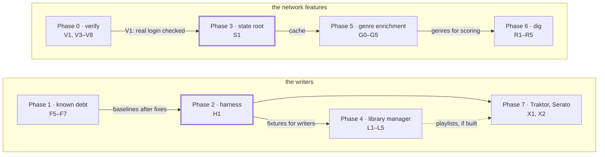

# selecta plan

What comes next for selecta, and in what order: verification first, then
foundations, then the new features. Close the open checks on what is built
(Phase 0), clear the known debt (Phase 1), and build two foundations: a
regression harness (Phase 2) and a place for state that persists between runs
(Phase 3). The five planned features come after that. None of them has been
started.

This is a plan, not a record of state. [README.md](../README.md) says what each
command does today, and [CLAUDE.md](../CLAUDE.md) says how it works. Where this
plan and CLAUDE.md disagree about what exists, CLAUDE.md wins.

## How this plan works

**Lanes.** Each phase is a lane with its own prefix. Every ticket has a stable
anchor, its id in lowercase (`#f5`), which does not change when its heading
does.

| Prefix | Lane |
| --- | --- |
| V | Phase 0: verification |
| F | Phase 1: known debt (fixes) |
| H | Phase 2: the regression harness |
| S | Phase 3: the state root |
| L | Phase 4: the library manager |
| G | Phase 5: genre enrichment. G0 comes before Phases 5 and 6 |
| R | Phase 6: `dig`, records not yet in the library |
| X | Phase 7: export to Traktor and Serato |
| W | Outside the phases: small changes to the page |
| DOC | Outside the phases: the product's documents, vision, architecture, design, testing strategy, and verification and validation |
| SCM | Outside the phases: source control and delivery, CI, branching, protection, releases and versioning |
| D | Decisions. These are not tickets |

**Ids.** Tickets keep the ids they were first planned under, so V starts at V1
with no V2, and F starts at F5: V2 and F1–F4 were done before this plan was
written, and the [log](#log) keeps what they found that the open tickets need.
An id is never reused or renumbered.

**Needs and order.** *Needs* is a hard need: the ticket cannot start until that
ticket is done, and in the GitHub Project it is a blocked-by link. *After* is
order only, a choice that can change. A phase's needs from
[Sequence and dependencies](#sequence-and-dependencies) are hard needs only for
the tickets that use what the other phase delivers. For the phase's other
tickets they are an *after*, and the phase's introduction says which is which.
A ticket that needs an open decision stays `backlog` in the Project until the
decision is made, because a decision has no issue to link.

**Size** ends each open ticket's heading, before *parked*, and is the same
value as its issue's `Size` in the ecosystem's GitHub Project, on the
ecosystem's scale: **xxs** takes minutes, **xs** under an hour, **s** an hour
or two, **m** about a session, **l** two or three, **xl** four to six and
**xxl** more. **tbd** means an open decision, a parked gate or work not yet
planned decides it. A change to one is made to the other in the same session.

**Done when** is a ticket's acceptance check. Once it holds, the ticket's
heading ends in *done*, it gets a *Result*, and the [log](#log) records what the
work found.

**Priority.** The dependency diagram puts the phases in three columns, which
map onto the Project's priorities: Phases 0 and 1 (*now*) are P1, Phases 2 and
3 (*foundations*) are P2, and Phases 4–7 (*features*) are P3. W1, DOC1 and SCM1
are P2. A priority set in the Project overrides this.

**Adding work.** A new ticket takes the next number in its lane. A split ticket
keeps its number and adds a letter (F6a, F6b). A new lane takes a prefix no
lane uses, and the ecosystem's shared rules say what to check before adding
one. **Confidential work never goes in this file**; the ecosystem's shared rules
say where it goes. Every open ticket has exactly one GitHub issue, titled
`<id>: <title>`, whose body links the ticket's anchor and copies nothing from
it. A new ticket gets its issue when it is added.

## Where selecta stands

Checked 2026-11-18. All seven commands run natively, in `selecta web`, and in
the browser build. Version 0.2.0, no test suite and no CI. This is what is
still open in each command:

| Command | Status | What is still open | Tickets |
| --- | --- | --- | --- |
| `catalog` | partial | The export reads `.mp3` only | None: the `.mp3`-only export is deferred ([Phase 1](#deferred-on-purpose)) |
| `duplicates` | done | Nothing. Baseline: 158 groups from 3,664 files in 9m12s | — |
| `rekordbox` | partial | Cannot read `export.pdb`. Artists are blank on a run from the local database alone | [F6](#f6). Blank artists have no ticket: attaching the USB fills them (CLAUDE.md) |
| `analyze` | done | Cue points and waveforms are skipped on purpose | — |
| `quality` | done | The Rekordbox columns are blank for a USB without the local library behind it, because `export.pdb` is unread | [F6](#f6) |
| `playlist-diff` | done | No saved login in the CLI or `selecta web`. Spotify only serves playlists you own or collaborate on | [S1](#s1). The second is Spotify's rule |
| `playlist-export` | done | No saved login in the CLI or `selecta web`. Spotify only serves playlists you own or collaborate on | [S1](#s1). The second is Spotify's rule |

Of the front ends, `selecta web` is done. Its one planned item, a timeline view
of `analyze`'s phrases, is deferred ([Phase 1](#deferred-on-purpose)). The
browser build runs every command and deploys to selecta.eigenomar.com. The
playlist commands were checked there with a real Spotify login on 2026-11-19
([V1](#v1)), and the build has never been tested in Firefox or Safari
([V3](#v3)).

The five planned features are the library manager, Serato/Traktor export,
rbxport integration, genre enrichment and `selecta dig`. They are designed in
the README's [Ideas](../README.md#ideas--not-implemented) section, and none has
any code yet.

## Rules every phase keeps

No phase in this plan relaxes any of these rules. A task that seems to need an
exception is a task to redesign.

- **Features import `selecta.core`, never a sibling.** When two features need
  the same code, it moves to `core` first. `playlist_diff/matching.py` is the
  next candidate, once enrichment or `dig` needs "is this the same track"
  ([G1](#g1)).
- **`add_parser` is argparse only.** A new dependency becomes an extra, imported
  inside the handler, and `selecta --help` keeps working without it.
- **Read-only commands stay read-only.** Each writer gets its own command. It
  backs up `master.db` before writing and refuses to run while Rekordbox has the
  file open.
- **Front ends import no feature.** Behaviour only the browser needs goes through
  a hook in `core`, like `core.tools.runner` and `core.spotify.transport`. No
  feature checks whether it is running in a browser.
- **The browser CSP stays closed.** Today it allows two Spotify hosts and
  nothing else. Adding any origin is a decision recorded in this plan.
- **Every change is checked with a measured run** on the reference clone, and
  each figure states how many tracks it was measured on.

## Phase 0 — Close the verification gaps

The check no simulation could stand in for, a real Spotify login
([V1](#v1)), passed on 2026-11-19. A real Cloudflare deploy of the browser build was checked on
2026-11-09 ([log](#log)). Beyond that, both front ends were tested only against
fakes: a simulated Spotify API, `wrangler dev`, and headless Edge driven through
CDP. This phase needs no new code unless a check fails.

Each ticket here is done when its check passes, or when its result is written
into the README as a known limit. The phase is done when all of them are. No
ticket in this phase needs another.

### V1 · Real Spotify login with a real client ID · *done*

- **Check:** run `playlist-export` and `playlist-diff` from the CLI, from
  `selecta web` and from the browser build. This includes the `/me` 403 for an
  account that is not on the app's user list.
- **Done when:** both commands read a real playlist with a real client ID from
  each of the three front ends, and an account that is not on the app's user
  list gets the `/me` 403 message. Otherwise, the README records the limit.
- **Before the check:** the Spotify app lists `https://selecta.eigenomar.com/`
  among its redirect URIs. The browser build sends its own origin, so a login
  from the live site fails until it is registered. Done on 2026-11-19
  ([log](#log)).
- **Needs:** nothing.
- **Result:** both commands read a real playlist with a real client ID from
  the CLI, `selecta web` and the live site, and an account not on the app's
  user list got the `/me` 403 message. Nothing failed, so the README records
  no new limit ([log](#log)).

### V3 · Firefox and Safari · s

- **Check:** the `webkitdirectory` picker, the module worker, and cancel through
  SharedArrayBuffer.
- **Done when:** all three work in both browsers, or the README says where they
  don't.
- **Needs:** nothing.

### V4 · Real pickers · xs

- **Check:** `showDirectoryPicker` on a real folder, a drive root (`D:\`) in
  both pickers, and `master.db` picked through the real Windows file dialog.
- **Done when:** each pick mounts and a command runs on it, or the README
  records the limit.
- **Needs:** nothing.

### V5 · Browser runs at library scale · s

- **Check:** `rekordbox` with fingerprints over all 3,664 tracks in a tab, and
  `quality` on a file several hours long.
- **Done when:** both finish in a tab, or the README records the limit.
- **Needs:** nothing.

### V6 · The `duplicates` stall in Edge · s

- **Check:** one run over 3,664 tracks stopped after about 27 minutes of CPU,
  and the rerun finished. Repeat the run 2–3 times. If it stalls again, capture
  the worker's state before closing the tab.
- **Done when:** 2–3 more runs finish, or a stall's worker state is captured and
  the README records the limit.
- **Needs:** nothing.

### V7 · The three cancel paths no test could time · s

- **Check:** the grace-period fallback, a cancel that lands as a run ends, and a
  cancel sent while the run waits behind another call.
- **Done when:** each of the three ends with no report changed, as the other
  cancel paths do, or the README records the limit.
- **Needs:** nothing.

### V8 · Encoding leftovers · xs

- **Check:** redirect `quality` and `playlist-export` output on a file with a
  name outside cp1252. Do one run on POSIX.
- **Done when:** both redirected runs exit 0 with every report written, and the
  POSIX run's result is recorded. Otherwise, the README records the limit.
- **Needs:** nothing.

## Phase 1 — Known debt in what exists

F5 was a small, local fix with a check that was already known, and is done. F6,
an `export.pdb` reader, is the one sizeable piece of work: it fills the last gap
shared by `quality` and `rekordbox`. Each ticket's check is its *done when*.

### F5 · fpcalc cannot fingerprint a file whose name contains a lone surrogate · *done*

- **Where:** `core/fingerprint.py`.
- **Change:** find out first whether the name is lost when fpcalc converts its
  argument. If so, fingerprint the file through a temporary name made of plain
  characters.
- **Done when:** the two fixture files fingerprint, and each matches its copy
  saved under an ordinary name.
- **Needs:** nothing.
- **Result:** the name was lost in fpcalc's own conversion of its argument to
  UTF-8. On Windows, a path with no UTF-8 form is now fingerprinted through a
  copy under `tmp/`. Both fixtures fingerprint, identical to their copies, and
  a report on 646 files with no such name is byte-identical before and after
  ([log](#log)).

### F6 · `export.pdb` is unread · l

- **Where:** a new reader in `core`.
- **Change:** a Python reader for the DeviceSQL tables `quality` and
  `rekordbox` need. Check it against rbxport's `rbl-pdb`, built at a pinned
  commit outside this tree. That build is the oracle Phase 4 extends
  ([L1](#l1)).
- **Done when:** its rows equal `rbl-pdb`'s on the reference USB, and a run of
  `quality` on the USB alone, with no local library behind it, fills the `rb_`
  columns. Today that run matches 0 rows, against 3,069 of 3,664 with the local
  library.
- **Needs:** nothing. **After:** F5.

### F7 · The ffmpeg tool still carries the old prefix · *done*

- **Where:** `wasm/sdm_ffmpeg.c`, `wasm/build.sh`, `wasm/prebuilt/`,
  `build_browser.py`'s `TOOL_FILES` and `TOOL_SOURCES`,
  `frontend/src/browser/tools.ts`, and the README's and `CLAUDE.md`'s lines on
  the audio tools.
- **Change:** rename the tool to `selecta_ffmpeg`: its source, its error
  messages and the files it builds. Rename `build.sh`'s cache folder to
  `selecta-ffmpeg-wasm`, and point its comment at `selecta.core.tools`. Rebuild
  `wasm/prebuilt/` with `wsl bash wasm/build.sh`, since `stamp.json` hashes the
  sources.
- **Done when:** `git grep -i sdm` finds only this plan, `build_browser.py`
  accepts the new stamp, and `quality` in the browser build gives the same
  output as before the rename on the same files.
- **Needs:** nothing, though the rebuild needs Linux or WSL. **After:** F5.
- **Result:** the tool is `selecta_ffmpeg`, rebuilt into `wasm/prebuilt/` with
  a new stamp, and `quality`'s report is byte-identical before and after on
  23 files ([log](#log)). Done before F5, which was only an *after*.

### Deferred on purpose

Two items are deferred on purpose. They are not tickets.

- **Non-MP3 files in the `catalog` export.** Adding them would change the
  export, which is the regression baseline. `--missing-metadata` already covers
  every format in `AUDIO_EXTS`.
- **The phrase timeline in `selecta web`.** It is a new view, not debt. Build it
  whenever the work on the page is convenient.

## Phase 2 — A regression harness before the first writer

Before the first writer, write one local script that reruns the baselines in
CLAUDE.md and fails on any difference. Today every baseline is checked by hand.
No verification script is tracked, and the `puppeteer-core` drivers used for
the browser checks are not in the tree. A regression in a reader produces a
wrong report. In the writers of Phases 4 and 7, it produces lost data.

This phase needs Phase 1: the baselines are taken after its fixes.

### H1 · The regression harness · l

**What it is.** The script runs each command on the reference clone into a
scratch `--out-dir`. It compares the counts and the SHA-256 of every report that
should come out byte-identical against a baseline file in JSON. The baseline can
be tracked even though the reports cannot, because `.gitignore` excludes every
`*.csv` and `*.txt`. The clone's path comes from an environment variable, and
the clone and the fixture playlists stay out of git.

| Tier | Runs | Fails when | Native time (measured) |
| --- | --- | --- | --- |
| Quick | `catalog` with a backslash path, `catalog --missing-metadata`, `analyze`, `rekordbox --export-csv`, `playlist-diff` against the fixture playlist CSVs | A hash changes. The audit is not `is_valid: True`. A count moves off its baseline: 36 tracks missing metadata, 3,655 beat grids, 3,646 tracks with phrases, 76,118 phrases, 0 unknown labels | `catalog` 8.3 s, `--missing-metadata` 5.6 s, `analyze` 49 s warm, all on 3,664–3,665 tracks |
| Slow | `duplicates`, `quality --limit 100` | The count moves off 158 groups, 178 confirmed pairs or 64,157 candidate pairs. The 100-track `quality` CSV is not identical | 9m12s on 3,664 tracks; about 2m15s on 100 tracks at 8 jobs |
| Full | `quality` on the whole clone | The count moves off 484 flagged tracks or off the per-kind counts | 52m20s warm on 3,664 tracks |
| Browser | The `puppeteer-core` driver, committed, against `wrangler dev` | A report differs from native once paths are mapped | `catalog` 21 s, `analyze` 85–88 s, on the reference USB |

**Writer fixtures.** The harness also keeps a scratch copy of `master.db` and
the 12-track set, six duplicate pairs, already used for the browser checks.
Every writer test runs against copies only. A writer that touches the original
in a test is a bug.

- **Done when:** the quick tier passes on the current tree, and fails after a
  threshold in `quality/compare.py` is changed on purpose.
- **Needs:** [F5](#f5), [F6](#f6). F1–F4 are done ([log](#log)).

## Phase 3 — A place for state that persists

Add a third root to `core/paths.py` for state that must outlive a run. Ship the
saved Spotify login on it first. Two things are waiting for this location
already: the CLI and `selecta web` log in on every run, and `dig` and enrichment
cannot work without an HTTP cache. Neither `out/` nor `tmp/` can hold this
state, because `out/` holds reports and `tmp/` is deleted on exit.

This phase needs the real Spotify login checked first ([V1](#v1)), done on
2026-11-19.

### S1 · The state root, with the saved Spotify login · m

**Proposal.** A `state` root, set the way the other two are: `--state-dir`, then
`SELECTA_STATE_DIR`, then a default. The default is per-user,
`%LOCALAPPDATA%\selecta` on Windows and `$XDG_STATE_HOME/selecta`, by default
`~/.local/state/selecta`, on Linux, rather than `./state`, because a refresh
token is a credential and should not sit in a project folder
([D1](#open-decisions)). It holds two things:

- **`spotify/`: the login.** It stores the refresh token and renews it 5 minutes
  before expiry, the way the browser build already does. Add a `--logout` option
  or a flag to delete it. Only `core/spotify.py` reads or writes this folder.
- **`cache/<source>/`: HTTP responses for the network features.** Each response
  is stored with the time it was fetched, and each source sets its own expiry.
  This cache is the difference between usable and unusable at MusicBrainz's 1
  request per second. Looking up 3,664 tracks once is about 61 minutes uncached,
  and seconds when cached.

The browser build does not change. Its login stays in localStorage, and nothing
in this phase runs in a tab.

- **Done when:** two `playlist-export` runs in a row open the browser only once,
  and deleting the state folder makes the next run log in again. The README's
  *Saved login* row then moves to done for the CLI and for `selecta web`.
- **Needs:** [V1](#v1). [D1](#open-decisions) is decided.

## Phase 4 — Library manager, with rbxport as the oracle

Start the manager as a playlist producer, and hand the writing to Rekordbox or
rbxport. rbxport already edits playlists, tags, cues and beat grids on the same
library, with its own backup and undo, so a writer of selecta's own is worth
building only if handing off fails. This keeps every selecta command read-only
for as long as possible.

The tickets that import into Rekordbox or write need [H1](#h1), whose writer
fixtures they use: L2 and L4, and L5 through them. L1 and L3 touch no library,
so for them H1 is an *after*.

### L1 · Extend the oracle from Phase 1 · s

- **Change:** add `rbl-onelibrary` and `rbl-anlz` at the same pinned commit as
  `rbl-pdb` ([F6](#f6)). Diff their output on the reference USB against
  `core/anlz.py`.
- **Done when:** both build at `rbl-pdb`'s pinned commit, and their output on
  the reference USB is diffed against `core/anlz.py`'s, with every difference
  recorded in the [log](#log).
- **Needs:** [F6](#f6). **After:** H1.

### L2 · Find out what rbxport and Rekordbox import · m

- **Change:** Rekordbox XML is the likely format, and `rbl-db` has a module for
  it. Record which playlist fields survive the import: order, nesting and names.
- **Done when:** this plan records the format, and whether order, nesting and
  names each survive an import into Rekordbox and into rbxport.
- **Needs:** [H1](#h1). **After:** L1.

### L3 · Produce playlists from reports · m

- **Change:** a new feature (name to be decided) turns existing reports into
  importable playlists, written to `out/`:
  - one keeper from each `duplicates` group,
  - the owned tracks from `playlist-diff`,
  - the tracks `quality` flagged, by issue kind.
- **Done when:** the feature writes all three kinds of playlist to `out/` in
  the format L2 found, from existing reports, and reads nothing else.
- **Needs:** [L2](#l2), which needs H1.

### L4 · Import them into Rekordbox for real · s

- **Change:** check against a scratch copy of `master.db` from H1's fixtures,
  never the live library. Diff the database before and after with
  `rbl-difftool`.
- **Done when:** L3's playlists are imported into a scratch copy of `master.db`
  from H1's fixtures, and `rbl-difftool`'s diff of that copy, before and after,
  is recorded in the [log](#log).
- **Needs:** [L3](#l3), [H1](#h1).

### L5 · Decide on direct writes · tbd

- **Change:** build a writer to `master.db` only if L2–L4 show that importing
  cannot do the job. If one is built, it is its own command. It backs up
  `master.db` first, refuses to run while Rekordbox has the file open, and reads
  through `core/rekordbox_db.py`. Tag edits and moving analysis data in or out
  follow the same rules, and rbxport covers most of what they would do.
- **Done when:** whether a writer is built is recorded in D2's row. If one is
  built, its tests pass on H1's writer fixtures and never touch the original.
- **Needs:** [L2](#l2), [L3](#l3), [L4](#l4). [D2](#open-decisions) is decided:
  hand off first.

## Phases 5 and 6 — Genre enrichment, then `dig`

Build enrichment first, as a read-only report. `dig` cannot score a result as a
percentile within its genre until the genres of the owned tracks are known. Both
phases need the cache from Phase 3 ([S1](#s1)). Both also need the same shared
code in `core`: source adapters ([G2](#g2)) and the same-track matcher
([G1](#g1)).

### G0 · Before either phase: re-verify the source table · s

- **Change:** re-verify the README's source table, because access rules move.
  Spotify's February 2026 changes are the precedent: 10 results per search page,
  `popularity` gone for new apps, 5 users per app.
- **Done when:** the README's source table gives each source's current access
  rules and the date they were checked.
- **Needs:** nothing.

### Phase 5 — Genre enrichment

The tickets that call a source need [S1](#s1)'s cache and [G0](#g0)'s source
table: G3, and G4 through it. G2 needs G0, which says which sources need keys,
and S1 is an *after* for it. G1 moves code and calls no source, so for it both
are an *after*.

#### G1 · Move the matcher · xs

- **Change:** `playlist_diff/matching.py` moves to `core`, as rule 1 requires.
- **Done when:** `playlist-diff`'s output stays byte-identical on the 3,628-row
  self-playlist.
- **Needs:** nothing. **After:** S1, G0.

#### G2 · One adapter interface in `core` · s

- **Change:** each source reads its key from an environment variable, and the
  command falls back to whichever sources have keys.
- **Done when:** the interface is in `core`, and a command with no keys set runs
  on the sources that need none instead of failing.
- **Needs:** [G0](#g0). **After:** G1, S1.

#### G3 · Add the sources in order · l

- **Change:** MusicBrainz first, for IDs (no key, 1 request per second, a
  User-Agent header required). Then Discogs styles (a token, about 60 requests
  per minute). Then Last.fm tags (an API key).
- **Done when:** each source is an adapter behind G2's interface, keeps to its
  rate limit, and fails on its own without breaking the command.
- **Needs:** [G2](#g2), [S1](#s1), [G0](#g0).

#### G4 · The report · s

- **Change:** one CSV row per track: path, MusicBrainz IDs, Discogs styles,
  Last.fm tags, and which source and match gave each value.
- **Done when:** the report is written for the reference clone with those
  columns, and the command writes nothing else.
- **Needs:** [G1](#g1), [G3](#g3).

#### G5 · Writing tags back · tbd · parked

- **Change:** comes later, as a separate writer command, and only on request.
- **Done when:** the writer is its own command, and its tests pass on H1's
  fixtures without touching an original file.
- **Needs:** [G4](#g4), [H1](#h1), and your request. Parked until then.

### Phase 6 — `dig`

Only the score, [R4](#r4), needs [G4](#g4), the genres of the owned tracks.
The others need Phase 5's shared code instead: [R1](#r1) needs the matcher
([G1](#g1)) and the Discogs adapter ([G3](#g3)), which brings the cache
([S1](#s1)) and [G0](#g0) with it, and the rest need R1. Enrichment still
comes first, as an *after*.

#### R1 · Discogs and the local cross-reference first · l

- **Change:** seeded by label: "what am I missing from this label". This needs
  one free token, and it is the half no website can do.
- **Done when:** `dig`, seeded by a label, lists that label's releases that the
  library does not own.
- **Needs:** [G1](#g1), [G3](#g3). **After:** G4.

#### R2 · Exclusions · s

- **Change:** exclude anything already owned (by name, and by fingerprint where
  one exists) and anything rejected before. A file of rejections goes under the
  state root.
- **Done when:** owned and rejected records never appear in `dig`'s results, and
  the rejections persist between runs under the state root.
- **Needs:** [R1](#r1), [S1](#s1).

#### R3 · Every result carries why it was returned · s

- **Change:** each result shows the hops from its seed.
- **Done when:** every row of `dig`'s report lists the hops from its seed.
- **Needs:** [R1](#r1).

#### R4 · The underground score · tbd

- **Change:** comes last. It is a composite percentile within the seed's genre,
  with each input shown in the report.
- **Done when:** every result carries the score and each input to it.
- **Needs:** [G4](#g4). **After:** R1–R3.

#### R5 · `dig` in the browser build · tbd · parked

- **Change:** not at first. `dig` would add at least three origins to
  `connect-src`, and whether those APIs allow CORS is unchecked.
- **Done when:** each source `dig` uses in a tab is checked for CORS, and the
  origins it adds are recorded in this plan as the CSP rule asks.
- **Needs:** [R1](#r1), the `dig` it would run in a tab. **After:** R2–R4.
  [D4](#open-decisions) is decided: later, so it stays parked until then.

## Phase 7 — Serato and Traktor export

Export to Traktor before Serato, because Traktor's export writes no audio file.
Traktor keeps the whole collection in one XML file, `collection.nml`. Serato
stores its analysis in `GEOB` frames inside each audio file. Nothing in selecta
modifies an audio file today, so writing those frames is new ground and comes
second. rbxport does not help here, since none of its crates targets either
format.

- **Shape:** a one-way export, as its own command, written to a destination USB
  and never to the source library. Every run ends with a report of what did not
  carry over. Phrase structure never does.
- **Inputs:** selecta's readers (`core/anlz.py` for beat grids, the database
  for BPM and key). The library manager's playlists, if Phase 4 has built them
  by then ([L3](#l3)). That is an input, not a need.
- **Check:** load the result in Traktor and in Serato. A file that parses
  correctly does not prove a player accepts it, as rbxport's own README warns.

Every ticket in this phase needs [H1](#h1).

### X1 · Export to Traktor · l

- **Change:** the export above, writing `collection.nml` to the destination.
- **Done when:** the result loads in Traktor, and the run's report lists what
  did not carry over.
- **Needs:** [H1](#h1).

### X2 · Export to Serato · xl

- **Change:** it copies files to the destination before writing `GEOB` frames,
  and never touches the originals. Its own regression check confirms each
  copy's audio stream is byte-identical apart from the tags.
- **Done when:** the result loads in Serato, the regression check passes, and
  the originals are unchanged.
- **Needs:** [H1](#h1). **After:** X1.

## Outside the phases

One small change needs none of the phases, so it can land at any time.

### W1 · A button back to eigenomar.com · xs

- **Change:** selecta has no footer, so the button goes at the foot of the
  sidebar, in the browser branch of `.sidebar-foot` in `frontend/src/App.tsx`.
  Make it a link to `https://eigenomar.com`, labelled `eigenomar.com`, with the
  `.button` styles. Open it in a new tab (`target="_blank" rel="noreferrer"`, as
  the app's other outside links do), because reports live in the tab and leaving
  would lose them. A link adds no origin, so the browser CSP stays closed.
- **Done when:** the button shows on selecta.eigenomar.com, works by keyboard,
  and opens eigenomar.com in a new tab while jobs and reports stay in place.
- **Needs:** nothing.

## Ecosystem standards

The ecosystem's contract, in `meta-eigenomar`, is adding two standards that
every repository adopts: the documents each one keeps, and how each one
manages its source and delivers it. DOC1 and SCM1 adopt them here, each once
its standard is designed, and until then their issues stay in the backlog.
Like W1, they are outside both tracks.

### DOC1 · The product's documents · tbd

- **Change:** write or gather selecta's product vision, architecture, design,
  testing strategy, and verification and validation (V&V) documents, in the
  shape the ecosystem's document standard sets. Where a file or section
  already covers one, name it rather than copy it. Today the README says what
  each command does, `CLAUDE.md` how it works, with its two architectural
  rules and its layout, and `docs/rekordbox.md` and `docs/analyze.md` the two
  formats it reads. [Rules every phase keeps](#rules-every-phase-keeps) and
  this plan's opening are the nearest thing to a vision. Phase 0's checks and
  [H1](#h1)'s harness are the verification and the testing strategy as they
  are planned, so the documents name them rather than restate them.
- **Done when:** each of the five documents exists, or names the file or
  section that holds it, and follows the standard's outline. `project.yaml`
  names them under the standard's keys, and the ecosystem's validator passes.
  Nothing in them is confidential, since this repository is public.
- **Needs:** the ecosystem's document standard (`meta-eigenomar` ST1).

### SCM1 · The ecosystem's SCM strategy · tbd

- **Change:** adopt the ecosystem's SCM strategy through its adoption
  checklist: CI, branching, protection of `main`, versioning and releases, the
  health report and dependency updates. Today selecta has no CI, and this plan
  accepts the gap ([Linux and other portability notes](#linux-and-other-portability-notes)):
  CI could install and build, but [H1](#h1) needs the reference library, which
  CI cannot have. Cloudflare's build deploys every push to `main`, there are
  no releases, and the audio tools are built on Linux or WSL and committed with
  their `stamp.json`.
- **Done when:** every item on the checklist is applied here, or recorded here
  as an exception the strategy allows, with its reason. `project.yaml`'s
  `delivery` and `CLAUDE.md` say what runs, any workflow passes on `main`, and
  the ecosystem's validator passes.
- **Needs:** the ecosystem's SCM strategy (`meta-eigenomar` ST2).

## Sequence and dependencies

The harness gates the writers, and the state root gates the network features.
An arrow runs from a prerequisite to the phase that needs it. The two
foundations are drawn thicker.

The top row leads to the writers and the bottom row to the network features.
The two tracks are independent, so they can be worked in parallel, and there is
no arrow between them. No phase has a date yet. The gates in the decisions
table below sit inside the phases, not between the boxes. W1, DOC1 and SCM1 are
outside both tracks. An arrow is a hard need only for the tickets of its phase
that use what it carries ([How this plan works](#how-this-plan-works)).

## Open decisions

These are yours to make. Each one blocks only the tickets in its row. When one
is made, its outcome and date go in its row, and the [log](#log) records it.
D1–D4 were made on 2026-11-13, so none is open today.

| Id | Decision | Options | Recommendation | Blocks | Outcome |
| --- | --- | --- | --- | --- | --- |
| D1 | Where persistent state lives | The per-user folder, or `./state` in the project | The per-user folder, which `SELECTA_STATE_DIR` can override | [S1](#s1), and through it Phases 5 and 6 | The per-user folder, 2026-11-13: `%LOCALAPPDATA%\selecta` on Windows, `$XDG_STATE_HOME/selecta` (by default `~/.local/state/selecta`) on Linux, and `--state-dir` or `SELECTA_STATE_DIR` over either |
| D2 | Who writes playlists | selecta writes `master.db` itself, or hands off through Rekordbox XML or rbxport | Hand off first | [L5](#l5) | Hand off first, 2026-11-13. L5 records whether a writer of selecta's own is needed |
| D3 | `catalog`'s exit code for a failed audit | Any non-zero code | One that is not 2, since `--missing-metadata` already uses 2 for a path that is not a directory | F2, done | 1, 2026-11-13 |
| D4 | `dig` in the browser build | Never, or later | Later, and only once the sources are known to allow CORS | [R5](#r5) | Later, 2026-11-13. R5 stays parked until `dig` exists and its sources are checked for CORS |

### Risks

- **The third-party APIs change.** Spotify, Discogs and Last.fm have each
  changed their access rules before. Each adapter must fail on its own, without
  breaking the command ([G3](#g3)).
- **A bug in a writer loses library data.** Four things guard against it: each
  writer is its own command, it backs up first, it refuses to run while
  Rekordbox has the file open, and its tests run on fixtures only ([H1](#h1)).
- **The browser `duplicates` stall has no known cause** ([V6](#v6)).
- **There is no CI.** The harness catches only what someone remembers to run.

## How selecta is built and delivered

What the tickets above work within, and what none of them changes on its own:

- **Build:** `pip install -e ".[all]"`, the page with npm in `frontend/`, the
  browser build with `build_browser.py`, and the audio tools with
  `wasm/build.sh`.
- **Tests:** none. Changes are verified by measured runs on the reference clone
  (CLAUDE.md), and by [H1](#h1) once it exists.
- **CI:** none (see *Linux* below). **Branching:** work lands on `main`.
  **Releases:** none. The version is in `pyproject.toml`.
- **Deployment:** Cloudflare's build of this repository deploys
  selecta.eigenomar.com on every push to `main` (README, *Build and deploy*). It
  serves `dist/`, which the build makes, so a file added to the repository is
  not served unless the build copies it.
- **Documents:** the README, CLAUDE.md, `docs/rekordbox.md`, `docs/analyze.md`,
  and this plan.
- **License:** MIT ([LICENSE](../LICENSE)).

### Linux and other portability notes

**Linux.** selecta has no CI, and this plan accepts the gap. Two things run on
Linux today. Cloudflare's build runs `build_browser.py` on every deploy, which
covers `npm ci`, the page's type check and build, and the wheels. The browser
build runs every command's Python in Pyodide, on POSIX paths. [V8](#v8) adds one
native POSIX run. Otherwise native commands, and `selecta web`'s jobs and their
signals, are unchecked on Linux. CI could only install and build here, because
[H1](#h1) needs the reference library, which CI cannot have.

**Other notes.**

- **The audio tools build only on Linux or in WSL.** `wasm/build.sh` needs a
  POSIX shell for FFmpeg's `configure`, which the ecosystem's portability
  conventions allow for a third-party build whose outputs are committed with a
  record of what they were built from. `wasm/prebuilt/` is committed,
  `stamp.json` records its sources, `build_browser.py` refuses to ship the
  modules once one of them has changed, and the README says how to run
  `build.sh`. The gap is accepted under that rule.
- **The drive letter's case.** There are no tests to start from `c:\`.
  `selecta web` compares paths through `os.path.normcase`, so the case does not
  matter there. `catalog`'s audit makes its directory absolute first.
- **[S1](#s1)'s default.** `%LOCALAPPDATA%\selecta` on Windows and
  `$XDG_STATE_HOME/selecta`, by default `~/.local/state/selecta`, on Linux
  ([D1](#open-decisions)).
- **Line endings:** every text file is LF, in the index and on checkout
  (`.gitattributes`).

## Log

- **2026-11-19 · F5** · Done. The name reaches fpcalc intact: a Python child
  given the same argv reads it whole and finds the file. fpcalc 1.6.1 opens
  Cyrillic and Korean names, so it converts its wide argv to UTF-8 for FFmpeg,
  and a lone surrogate has no UTF-8 form, so it was replaced and FFmpeg
  reported "No such file". `compute` now copies such a file into a
  `paths.scratch` under `tmp/`, fingerprints the copy, and deletes it once
  fpcalc exits. This happens only on Windows: on POSIX the
  escaped bytes reach fpcalc unchanged, and the browser build is POSIX. It is a
  copy rather than a hard link, because a link needs `tmp/` on the library's
  volume, and FAT and exFAT have none. Fixtures: two tracks, each saved as
  `high \ud800 surrogate.mp3` or `low \udc00 surrogate.mp3` and under a plain
  name. Each fingerprints, with all 948 integers and the duration identical to
  its copy's, and `tmp/` is empty afterwards. `duplicates` on the four files
  went from 2 unfingerprintable and 0 groups to 0 and 2 groups. A file that
  vanishes before the copy fingerprints as None, and a missing fpcalc still
  raises. On a local folder of 646 files with no such name (2,084 candidate
  pairs, 265 groups, 1m40s), the CSV, the JSON and the log are byte-identical
  before and after. The reference clone has no such name, so its baseline
  cannot move, and it was not rerun.
- **2026-11-19 · V1** · Done, checked by hand by the owner with their own
  Spotify app and client ID: `playlist-export` and `playlist-diff` each read a
  real playlist from the CLI, from `selecta web` and from the browser build at
  selecta.eigenomar.com, and an account that is not on the app's user list got
  the `/me` 403 message. Nothing failed. S1, which needed V1, can start.
- **2026-11-19 · F7** · Done: the ffmpeg tool is `selecta_ffmpeg`, in
  `wasm/selecta_ffmpeg.c`, its error messages, `build.sh`, `build_browser.py`'s
  `TOOL_FILES` and `TOOL_SOURCES`, `tools.ts`'s `TOOL_FILES`, and the README's
  and CLAUDE.md's lines. `build.sh`'s cache folder is `selecta-ffmpeg-wasm` and
  its comment names `selecta.core.tools`. The rebuild in WSL took 2m38s, with
  the old cache's Emscripten and tarballs copied in, so FFmpeg was configured
  afresh: ffprobe embeds its configure line, which named the old cache folder.
  `fpcalc.wasm` and every `.mjs` but the renamed one came out byte-identical,
  and `build_browser.py --no-install` accepts the new stamp. `git grep -i` for
  the old prefix finds only this plan. Checked on 23 local files (10 MP3, 4 WAV,
  2 M4A, 4 FLAC, 3 AIFF), with each tool run in Node through the same glue and
  calls as `tools.ts`: fpcalc's and ffprobe's output and the ffmpeg tool's
  samples are byte-identical to the old modules', and its stderr differs only
  in heap addresses, each 0x10 higher. `quality --no-rekordbox --jobs 1` on the
  23 files, with `core.tools.runner` set to the WebAssembly tools as
  `selecta.browser` sets it, writes a byte-identical report on the old and new
  modules. Under `wrangler dev` the page serves `tools/<hash>/selecta_ffmpeg`
  with its COOP, COEP and immutable caching, and the old name is a 404. Not
  done: a `quality` run through the page's own form.
- **2026-11-19 · V1** · The Spotify app lists `https://selecta.eigenomar.com/`
  among its redirect URIs, and the owner logged in from the live site. V1's
  check, both commands from all three front ends and the `/me` 403, is still
  to run.
- **2026-11-18 · plan** · F7 added, at the owner's request: the ffmpeg tool,
  its build's cache folder and a comment still carry the old prefix, and
  renaming them means rebuilding `wasm/prebuilt/`.
- **2026-11-18 · plan** · This plan starts in this repository with its open
  tickets, each keeping its id, anchor and issue, the decisions D1–D4 as they
  were made, and the entries below that the open tickets need. The state root's
  folder and variable take the package's name: `selecta` and
  `SELECTA_STATE_DIR` (D1). The repository is MIT-licensed.
- **2026-11-18 · F4** · Done: the dead ANLZ parser in `features/rekordbox/` is
  deleted. `core/anlz.py` is the only ANLZ reader. On the local library (3,514
  tracks), `rekordbox --export-csv`, `--duplicates-by-name`'s CSV and JSON and
  both `--help` outputs were byte-identical before and after.
- **2026-11-18 · DOC1, SCM1** · Added, in two new lanes, at the owner's
  request: the adoption of the ecosystem's document standard and SCM strategy,
  which are designed in `meta-eigenomar`. Each needs its standard, so its issue
  waits in the backlog.
- **2026-11-14 · F3** · Done: `rekordbox` borrows fpcalc when none is
  installed, and pre-flights it, through the pre-flight `duplicates` used, now
  `core.duplicates.fingerprint_preflight`, which tries only tracks whose file
  exists. It also gained `--no-fetch-fpcalc`. On the local library (3,514
  tracks, 290 candidate pairs, 492 fingerprinted, 6 groups), the report with a
  borrowed fpcalc is byte-identical to the one with fpcalc 1.6.1 on PATH.
- **2026-11-14 · F2** · Done: a failed `catalog` audit exits 1, as D3 decided,
  so a script can gate on it and both front ends show the job as failed.
  `--missing-metadata` still exits 0, and 2 for a path that is not a directory.
- **2026-11-14 · F1** · Done: `catalog` makes its directory absolute before the
  export, so any path style passes the audit: forward slashes, backslashes, a
  trailing slash and relative paths give byte-identical CSVs and sidecars. The
  sidecar always holds absolute paths, and the backslash run is byte-identical
  to the one before the fix, so H1's quick tier can take it as its baseline.
- **2026-11-13 · plan** · D1–D4 decided: the state root is per-user on both
  platforms, playlists are handed off first, a failed audit exits 1, and `dig`
  comes to the browser later. The needs follow the ecosystem's rule for needs
  between phases: a phase's need is a hard need only for the tickets that use
  what the other phase delivers. So L1, L3, G1, G2, R1, R2, R3 and R5 have a
  phase-level *after* rather than a need, R1 needs the matcher and the Discogs
  adapter, and R5 needs R1. The audio tools' Linux-or-WSL build is accepted under
  the ecosystem's rule for third-party builds that need a POSIX shell.
- **2026-11-09 · V2** · Done: a real Cloudflare deploy of the browser build
  answered 200 with COOP `same-origin`, COEP `require-corp` and the CSP intact,
  its page bundle had the Spotify login, and its worker named `fpcalc`,
  `ffprobe` and `sdm_ffmpeg`. The deploy succeeded, so the 31 files fit
  Cloudflare's limits. No command was run on the live site.
