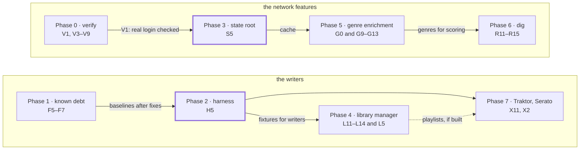

# selecta plan

What comes next for selecta, and in what order: verification first, then
foundations, then the new features. Close the open checks on what is built
(Phase 0), clear the known debt (Phase 1), and build two foundations: a
regression harness (Phase 2) and a place for state that persists between runs
(Phase 3). The five planned features come after that. None of them has been
started.

This is a plan, not a record of state. [README.md](../README.md) says what each
command does today, and [CLAUDE.md](../CLAUDE.md) says how it works. Where this
plan and CLAUDE.md disagree about what exists, CLAUDE.md wins.

## How this plan works

**Lanes.** Each phase is a lane with its own prefix. Every ticket has a stable
anchor, its id in lowercase (`#f5`), which does not change when its heading
does.

| Prefix | Lane |
| --- | --- |
| V | Phase 0: verification |
| F | Phase 1: known debt (fixes) |
| H | Phase 2: the regression harness |
| S | Phase 3: the state root |
| L | Phase 4: the library manager |
| G | Phase 5: genre enrichment. G0 comes before Phases 5 and 6 |
| R | Phase 6: `dig`, records not yet in the library |
| X | Phase 7: export to Traktor and Serato |
| C | Outside the phases: `convert`, new audio files made from the library's |
| W | Outside the phases: small changes to the page |
| SET | Outside the phases: setcraft, composing and documenting DJ sets in the page |
| DOC | Outside the phases: the product's documents, vision, architecture, design, testing strategy, and verification and validation |
| SCM | Outside the phases: source control and delivery, CI, branching, protection, releases and versioning |
| D | Decisions. These are not tickets |

**Ids.** Tickets keep the ids they were first planned under, so V starts at V1
with no V2, and F starts at F5: V2 and F1–F4 were done before this plan was
written, and the [log](#log) keeps what they found that the open tickets need.
An id is never reused or renumbered.

**Needs and order.** *Needs* is a hard need: the ticket cannot start until that
ticket is done, and in the GitHub Project it is a blocked-by link. *After* is
order only, a choice that can change. A phase's needs from
[Sequence and dependencies](#sequence-and-dependencies) are hard needs only for
the tickets that use what the other phase delivers. For the phase's other
tickets they are an *after*, and the phase's introduction says which is which.
A ticket that needs an open decision stays `backlog` in the Project until the
decision is made, because a decision has no issue to link.

**Size** ends each open ticket's heading, before *parked*, and is the same
value as its issue's `Size` in the ecosystem's GitHub Project, on the
ecosystem's scale: **xxs** takes minutes, **xs** under an hour, **s** an hour
or two, **m** about a session, **l** two or three, **xl** four to six and
**xxl** more. **tbd** means an open decision, a parked gate or work not yet
planned decides it. A change to one is made to the other in the same session.

**Done when** is a ticket's acceptance check. Once it holds, the ticket's
heading ends in *done*, it gets a *Result*, and the [log](#log) records what the
work found.

**Priority.** The dependency diagram puts the phases in three columns, which
map onto the Project's priorities: Phases 0 and 1 (*now*) are P1, Phases 2 and
3 (*foundations*) are P2, and Phases 4–7 (*features*) are P3. W15–W18, W24, C4, DOC2
and SCM2 are P2, and C5 is P3. SET1–SET6 and SET12, setcraft's first version,
are P2, and the rest of the SET lane is P3. A priority set in the Project
overrides this.

**Adding work.** A new ticket takes the next number in its lane. A split ticket
keeps its number and adds a letter (F6a, F6b). A new lane takes a prefix no
lane uses, and the ecosystem's shared rules say what to check before adding
one. **Confidential work never goes in this file**; the ecosystem's shared rules
say where it goes. Every open ticket has exactly one GitHub issue, titled
`<id>: <title>`, whose body links the ticket's anchor and copies nothing from
it. A new ticket gets its issue when it is added.

## Where selecta stands

Checked 2026-11-18. All seven commands run natively, in `selecta web`, and in
the browser build. Version 0.2.0, no test suite and no CI. This is what is
still open in each command:

| Command | Status | What is still open | Tickets |
| --- | --- | --- | --- |
| `catalog` | partial | The export reads `.mp3` only | None: the `.mp3`-only export is deferred ([Phase 1](#deferred-on-purpose)) |
| `duplicates` | done | Nothing. Baseline: 158 groups from 3,664 files in 9m12s | — |
| `rekordbox` | partial | Artists are blank on a run from the local database alone. A USB's `export.pdb` is read since [F6](#f6), in the browser build too since [F9](#f9); its `exportLibrary.db` is not read | None: attaching the USB fills the artists (CLAUDE.md) |
| `analyze` | done | Cue points and waveforms are skipped on purpose | — |
| `quality` | done | Nothing. A USB alone gets its Rekordbox claims from its `export.pdb` since [F6](#f6), in the browser build too since [F9](#f9) | — |
| `playlist-diff` | done | No saved login in the CLI or `selecta web`. Spotify only serves playlists you own or collaborate on | [S5](#s5). The second is Spotify's rule |
| `playlist-export` | done | No saved login in the CLI or `selecta web`. Spotify only serves playlists you own or collaborate on | [S5](#s5). The second is Spotify's rule |

Of the front ends, `selecta web` is done. Its one planned item, a timeline view
of `analyze`'s phrases, is deferred ([Phase 1](#deferred-on-purpose)). The
browser build runs every command and deploys to selecta.eigenomar.com. The
playlist commands were checked there with a real Spotify login on 2026-11-19
([V1](#v1)). Firefox was checked on 2026-11-24 ([V3](#v3)). In WebKit, runs
over a real library's files fail ([V9](#v9)), and real Safari is untested.

The five planned features are the library manager, Serato/Traktor export,
rbxport integration, genre enrichment and `selecta dig`. They are designed in
the README's [Ideas](../README.md#ideas--not-implemented) section, and none has
any code yet. Setcraft, a part of the page for composing DJ sets, is planned in
[the SET lane](#the-set-lane-setcraft) and has no code yet either.

## Rules every phase keeps

No phase in this plan relaxes any of these rules. A task that seems to need an
exception is a task to redesign.

- **Features import `selecta.core`, never a sibling.** When two features need
  the same code, it moves to `core` first. `playlist_diff/matching.py` is the
  next candidate, once enrichment or `dig` needs "is this the same track"
  ([G9](#g9)).
- **`add_parser` is argparse only.** A new dependency becomes an extra, imported
  inside the handler, and `selecta --help` keeps working without it.
- **Read-only commands stay read-only.** Each writer gets its own command. It
  backs up `master.db` before writing and refuses to run while Rekordbox has the
  file open.
- **Front ends import no feature.** Behaviour only the browser needs goes through
  a hook in `core`, like `core.tools.runner` and `core.spotify.transport`. No
  feature checks whether it is running in a browser.
- **The browser CSP stays closed.** Today it allows two Spotify hosts and
  nothing else. Adding any origin is a decision recorded in this plan.
- **Every change is checked with a measured run** on the reference clone, and
  each figure states how many tracks it was measured on.

## Phase 0 — Close the verification gaps

The check no simulation could stand in for, a real Spotify login
([V1](#v1)), passed on 2026-11-19. The real pickers ([V4](#v4)) passed by hand
on 2026-11-21, and the library-scale runs ([V5](#v5)) and the three cancel
paths ([V7](#v7)) on 2026-11-24. The same day, a session checked Firefox and
WebKit ([V3](#v3)) and the encoding leftovers ([V8](#v8)), and WebKit's failure
to read the clone's files became [V9](#v9). A real Cloudflare deploy of the browser build was checked on
2026-11-09 ([log](#log)). Beyond that, both front ends were tested only against
fakes: a simulated Spotify API, `wrangler dev`, and headless Edge driven through
CDP. This phase needs no new code unless a check fails.

Each ticket here is done when its check passes, or when its result is written
into the README as a known limit. The phase is done when all of them are. No
ticket in this phase needs another.

### V1 · Real Spotify login with a real client ID · *done*

- **Check:** run `playlist-export` and `playlist-diff` from the CLI, from
  `selecta web` and from the browser build. This includes the `/me` 403 for an
  account that is not on the app's user list.
- **Done when:** both commands read a real playlist with a real client ID from
  each of the three front ends, and an account that is not on the app's user
  list gets the `/me` 403 message. Otherwise, the README records the limit.
- **Before the check:** the Spotify app lists `https://selecta.eigenomar.com/`
  among its redirect URIs. The browser build sends its own origin, so a login
  from the live site fails until it is registered. Done on 2026-11-19
  ([log](#log)).
- **Needs:** nothing.
- **Result:** both commands read a real playlist with a real client ID from
  the CLI, `selecta web` and the live site, and an account not on the app's
  user list got the `/me` 403 message. Nothing failed, so the README records
  no new limit ([log](#log)).

### V3 · Firefox and Safari · *done*

- **Check:** the `webkitdirectory` picker, the module worker, and cancel through
  SharedArrayBuffer.
- **Done when:** all three work in both browsers, or the README says where they
  don't.
- **How:** a session runs the three checks in Playwright's Firefox and WebKit.
  The developer decided on 2026-11-24 that WebKit on Windows stands in for
  Safari, rather than waiting for a Mac or an iPhone. The README records
  WebKit's results as WebKit's and says real Safari is untested ([log](#log)).
- **Needs:** nothing.
- **Result:** all three work in both, on the live site through Playwright
  1.64.1, Firefox 157.0 and WebKit 27.2 on Windows, both cross-origin isolated.
  Firefox ran `catalog` over the whole reference clone with reports identical
  to native, and a cancel stopped through the interrupt with exit code 130.
  WebKit passed the same three checks on a 1,001-file folder. But its runs
  over the clone's own files fail with a Pyodide fatal error while reading a
  picked file. The README records that as a limit, with real Safari untested,
  and [V9](#v9) takes the failure ([log](#log)).

### V4 · Real pickers · *done*

- **Check:** `showDirectoryPicker` on a real folder, a drive root (`D:\`) in
  both pickers, and `master.db` picked through the real Windows file dialog.
- **Done when:** each pick mounts and a command runs on it, or the README
  records the limit.
- **How:** [system tests, V4](system-tests.md#v4--real-pickers).
- **Needs:** nothing.
- **Result:** every pick mounted and its command ran on the live site, so the
  README records no new limit. That covers `showDirectoryPicker` on a real
  folder, `D:\` in both pickers, and the real `master.db` through the Windows
  file dialog, with Rekordbox closed and with it open. With *use the other
  picker*, the browser words the pick as an upload. That's the browser's own
  dialog, which the README already explains ([log](#log)).

### V5 · Browser runs at library scale · *done*

- **Check:** `rekordbox` with fingerprints over all 3,664 tracks in a tab, and
  `quality` on a file several hours long.
- **Done when:** both finish in a tab, or the README records the limit.
- **How:** [system tests, V5](system-tests.md#v5--browser-runs-at-library-scale),
  with native baselines measured on 2026-11-21.
- **Needs:** nothing.
- **Result:** 5.1 and 5.2 passed by hand on the live site, as the system tests
  define a pass, so the README records no new limit. The developer confirmed
  the pass, but the run's figures weren't noted: browser version, elapsed
  times and the tab's peak memory ([log](#log)).

### V6 · The `duplicates` stall in Edge · *done*

- **Check:** one run over 3,664 tracks stopped after about 27 minutes of CPU,
  and the rerun finished. Repeat the run 2–3 times. If it stalls again, capture
  the worker's state before closing the tab.
- **Done when:** 2–3 more runs finish, or a stall's worker state is captured and
  the README records the limit.
- **Needs:** nothing.
- **Result:** two more runs in headless Edge 158 both finished, in 21.4 and
  24.4 min, each with native's 158 groups and 178 of 64,157 pairs confirmed,
  and zero console errors. Nothing stalled, so the README records no limit.
  The first stall's cause stays unknown. The editor session driving that run
  restarted for an update, but the renderer's CPU time puts the stall about
  ten minutes before the restart ([log](#log)).

### V7 · The three cancel paths no test could time · *done*

- **Check:** the grace-period fallback, a cancel that lands as a run ends, and a
  cancel sent while the run waits behind another call.
- **Done when:** each of the three ends with no report changed, as the other
  cancel paths do, or the README records the limit.
- **How:** [system tests, V7](system-tests.md#v7--the-three-cancel-paths-no-test-could-time).
  The third path is checked as a run held up by its first install. A run held
  up behind another call can't be timed by hand.
- **Needs:** nothing.
- **Result:** 7.1, 7.2 and 7.3 passed by hand on the live site, as the system
  tests define a pass. Each ended with its own signature and with *After*
  holding, so the README records no new limit. The developer confirmed the
  pass, but the browser version and which signatures 7.2's three hand runs
  gave weren't noted. As planned, 7.3 covered a run held up by its first
  install. The exact case of a run queued behind another call is left to a
  scripted check, which [H5](#h5)'s browser tier could hold ([log](#log)).

### V8 · Encoding leftovers · *done*

- **Check:** redirect `quality` and `playlist-export` output on a file with a
  name outside cp1252. Do one run on POSIX.
- **Done when:** both redirected runs exit 0 with every report written, and the
  POSIX run's result is recorded. Otherwise, the README records the limit.
- **Needs:** nothing.
- **Result:** both exit 0 with every report written, on Windows and on POSIX,
  so the README records no limit. On Windows, stdout was the cp1252 file
  CLAUDE.md describes, and every name outside it printed as `\uXXXX`. The
  reports kept the real names in UTF-8. `playlist-export` ran against a fake
  Spotify, through the `supplied_token` and `transport` hooks, because a real
  login can't be done from a session. The POSIX run, in WSL's Ubuntu 22.04,
  covered `playlist-export` and `catalog`, not `quality`, which needs an
  ffprobe that WSL lacks ([log](#log)).

### V9 · WebKit can't read the clone's picked files · m

- **Check:** in Playwright's WebKit 27.2 on Windows, a run over files picked
  from the reference clone fails at its first read with a Pyodide fatal
  error, `NotFoundError: The object can not be found here.`, raised by the
  worker's `FileReaderSync` read. Sometimes it's `NoGilError` instead. Find out
  why, and whether real Safari does the same.
- **Done when:** the cause is known and fixed, or the README's limit says
  which browsers it covers and why.
- **Known so far:** whole-clone runs failed 3 of 3, and single files from the
  clone failed 6–9 of 10 per round, not the same files each round. Fresh
  copies of the same files mostly pass: a 1,001-file folder of hard links to
  one new copy passed 6 of 6. Firefox and Chromium read the same files without
  error. It isn't the names (`!`, `&`, `#`, `%`, non-ASCII), the hidden `._`
  stubs, the size of the pick, the 1,000-file staging chunks or the OS file
  cache ([log](#log)).
- **Needs:** nothing. A Mac or an iPhone would answer the Safari half.

## Phase 1 — Known debt in what exists

F5 was a small, local fix with a check that was already known. F6, an
`export.pdb` reader, filled the last gap shared by `quality` and `rekordbox`.
Both are done. F8 and F9 are two bugs F6's work found, added on 2026-11-20,
and both are done too.
Each ticket's check is its *done when*.

### F5 · fpcalc cannot fingerprint a file whose name contains a lone surrogate · *done*

- **Where:** `core/fingerprint.py`.
- **Change:** find out first whether the name is lost when fpcalc converts its
  argument. If so, fingerprint the file through a temporary name made of plain
  characters.
- **Done when:** the two fixture files fingerprint, and each matches its copy
  saved under an ordinary name.
- **Needs:** nothing.
- **Result:** the name was lost in fpcalc's own conversion of its argument to
  UTF-8. On Windows, a path with no UTF-8 form is now fingerprinted through a
  copy under `tmp/`. Both fixtures fingerprint, identical to their copies, and
  a report on 646 files with no such name is byte-identical before and after
  ([log](#log)).

### F6 · `export.pdb` is unread · *done*

- **Where:** a new reader in `core`.
- **Change:** a Python reader for the DeviceSQL tables `quality` and
  `rekordbox` need. Check it against rbxport's `rbl-pdb`, built at a pinned
  commit outside this tree. That build is the oracle Phase 4 extends
  ([L11](#l11)).
- **Done when:** its rows equal `rbl-pdb`'s on the reference USB, and a run of
  `quality` on the USB alone, with no local library behind it, fills the `rb_`
  columns. Today that run matches 0 rows, against 3,069 of 3,664 with the local
  library.
- **Needs:** nothing. **After:** F5.
- **Result:** `export.pdb` is not encrypted, so `core/pdb.py` reads it with
  the stdlib alone. Its rows equal `rbl-pdb`'s on the reference USB, built at
  rbxport `d0ff75b` (1.10.0): 3,587 tracks and the genres, artists, albums,
  labels and keys tables, every field in file order. `quality` on the USB
  alone now matches 3,586 of 3,664 files by path, and `rekordbox` reads the
  USB's exported BPM and key ([log](#log)).

### F7 · The ffmpeg tool still carries the old prefix · *done*

- **Where:** `wasm/sdm_ffmpeg.c`, `wasm/build.sh`, `wasm/prebuilt/`,
  `build_browser.py`'s `TOOL_FILES` and `TOOL_SOURCES`,
  `frontend/src/browser/tools.ts`, and the README's and `CLAUDE.md`'s lines on
  the audio tools.
- **Change:** rename the tool to `selecta_ffmpeg`: its source, its error
  messages and the files it builds. Rename `build.sh`'s cache folder to
  `selecta-ffmpeg-wasm`, and point its comment at `selecta.core.tools`. Rebuild
  `wasm/prebuilt/` with `wsl bash wasm/build.sh`, since `stamp.json` hashes the
  sources.
- **Done when:** `git grep -i sdm` finds only this plan, `build_browser.py`
  accepts the new stamp, and `quality` in the browser build gives the same
  output as before the rename on the same files.
- **Needs:** nothing, though the rebuild needs Linux or WSL. **After:** F5.
- **Result:** the tool is `selecta_ffmpeg`, rebuilt into `wasm/prebuilt/` with
  a new stamp, and `quality`'s report is byte-identical before and after on
  23 files ([log](#log)). Done before F5, which was only an *after*.

### F8 · pyrekordbox 0.5 cannot open `master.db` · *done*

- **Where:** `pyproject.toml`'s extras, and the message `quality` prints in
  `features/quality/command.py`.
- **Problem:** pyrekordbox 0.5.0 has no `pyrekordbox.db6`, which
  `core/rekordbox_db.py` imports, and the extras allow `pyrekordbox>=0.4.0`. A
  fresh install gets 0.5.0, so `rekordbox` and `quality` cannot open any
  `master.db`, the local library's included. `quality` then says
  `pyrekordbox.db6 is not installed`, which reads as a missing install. The
  browser build pins 0.4.4 and is not affected.
- **Change:** bound the extras below 0.5, as the browser build's pin already
  is. When the missing module is inside an installed package, say the
  installed version is not supported instead. Moving to 0.5's `masterdb` is a
  separate choice, for when there is a reason to.
- **Done when:** a fresh `pip install -e ".[all]"` installs pyrekordbox 0.4.x;
  `rekordbox --export-csv` reads the local library's 3,514 tracks; `quality
  --limit 100` on the reference clone reads the local library again; and with
  0.5.0 installed, the message names the unsupported version.
- **Needs:** nothing.
- **Result:** the extras are bounded `>=0.4.0,<0.5`, and a fresh install
  gets 0.4.4. `rekordbox --export-csv` reads the local library's 3,514 tracks,
  identically on two runs, and `quality --limit 100` reads it again. With
  0.5.0 installed, both commands name the version and the fix
  ([log](#log)).

### F9 · The browser build does not mount `export.pdb` · *done*

- **Where:** the mount filter, `frontend/src/browser/files.ts`, and the rules
  `selecta.browser.boot` gives it.
- **Problem:** a picked USB is mounted with its audio and `USBANLZ` only, so
  its `PIONEER/rekordbox/export.pdb` is not in the tab. `quality` and
  `rekordbox` on a USB alone therefore get none of the Rekordbox data
  [F6](#f6) reads natively.
- **Change:** mount the USB's `export.pdb` as well, with the rule in
  `browser.boot` beside the others, taken from `core.pdb.EXPORT_PDB` so the
  two cannot drift.
- **Done when:** in the browser build, with no `master.db` picked, `quality
  --limit 100` on the picked reference USB matches 100 of 100 files by path,
  and `rekordbox --export-csv` is byte-identical to native once paths are
  mapped.
- **Needs:** nothing. F6 is done.
- **Result:** `browser.boot`'s mount rules carry `core.pdb.EXPORT_PDB`, and
  the filter mounts it beside the audio and `USBANLZ`. In headless Edge with
  the CSP enforced and no `master.db` picked, `quality --limit 100` matches
  100 of 100 files by path, and `rekordbox --export-csv` is byte-identical to
  native ([log](#log)).

### Deferred on purpose

Two items are deferred on purpose. They are not tickets.

- **Non-MP3 files in the `catalog` export.** Adding them would change the
  export, which is the regression baseline. `--missing-metadata` already covers
  every format in `AUDIO_EXTS`.
- **The phrase timeline in `selecta web`.** It is a new view, not debt. Build it
  whenever the work on the page is convenient.

## Phase 2 — A regression harness before the first writer

Before the first writer, write one local script that reruns the baselines in
CLAUDE.md and fails on any difference. Today every baseline is checked by hand.
No verification script is tracked, and the `puppeteer-core` drivers used for
the browser checks are not in the tree. A regression in a reader produces a
wrong report. In the writers of Phases 4 and 7, it produces lost data.

This phase needs Phase 1: the baselines are taken after its fixes.

### H5 · The regression harness · l

**What it is.** The script runs each command on the reference clone into a
scratch `--out-dir`. It compares the counts and the SHA-256 of every report that
should come out byte-identical against a baseline file in JSON. The baseline can
be tracked even though the reports cannot, because `.gitignore` excludes every
`*.csv` and `*.txt`. The clone's path comes from an environment variable, and
the clone and the fixture playlists stay out of git.

| Tier | Runs | Fails when | Native time (measured) |
| --- | --- | --- | --- |
| Quick | `catalog` with a backslash path, `catalog --missing-metadata`, `analyze`, `rekordbox --export-csv`, `playlist-diff` against the fixture playlist CSVs | A hash changes. The audit is not `is_valid: True`. A count moves off its baseline: 36 tracks missing metadata, 3,655 beat grids, 3,646 tracks with phrases, 76,118 phrases, 0 unknown labels | `catalog` 8.3 s, `--missing-metadata` 5.6 s, `analyze` 49 s warm, all on 3,664–3,665 tracks |
| Slow | `duplicates`, `quality --limit 100` | The count moves off 158 groups, 178 confirmed pairs or 64,157 candidate pairs. The 100-track `quality` CSV is not identical | 9m12s on 3,664 tracks; about 2m15s on 100 tracks at 8 jobs |
| Full | `quality` on the whole clone | The count moves off 484 flagged tracks or off the per-kind counts | 52m20s warm on 3,664 tracks |
| Browser | The `puppeteer-core` driver, committed, against `wrangler dev` | A report differs from native once paths are mapped | `catalog` 21 s, `analyze` 85–88 s, on the reference USB |

**Writer fixtures.** The harness also keeps a scratch copy of `master.db` and
the 12-track set, six duplicate pairs, already used for the browser checks.
Every writer test runs against copies only. A writer that touches the original
in a test is a bug.

- **Done when:** the quick tier passes on the current tree, and fails after a
  threshold in `quality/compare.py` is changed on purpose.
- **Needs:** [F5](#f5), [F6](#f6), [F8](#f8): its quick tier reads the local
  library, which pyrekordbox 0.5 cannot open. F1–F4 are done ([log](#log)).

## Phase 3 — A place for state that persists

Add a third root to `core/paths.py` for state that must outlive a run. Ship the
saved Spotify login on it first. Two things are waiting for this location
already: the CLI and `selecta web` log in on every run, and `dig` and enrichment
cannot work without an HTTP cache. Neither `out/` nor `tmp/` can hold this
state, because `out/` holds reports and `tmp/` is deleted on exit.

This phase needs the real Spotify login checked first ([V1](#v1)), done on
2026-11-19.

### S5 · The state root, with the saved Spotify login · m

**Proposal.** A `state` root, set the way the other two are: `--state-dir`, then
`SELECTA_STATE_DIR`, then a default. The default is per-user,
`%LOCALAPPDATA%\selecta` on Windows and `$XDG_STATE_HOME/selecta`, by default
`~/.local/state/selecta`, on Linux, rather than `./state`, because a refresh
token is a credential and should not sit in a project folder
([D1](#open-decisions)). It holds two things:

- **`spotify/`: the login.** It stores the refresh token and renews it 5 minutes
  before expiry, the way the browser build already does. Add a `--logout` option
  or a flag to delete it. Only `core/spotify.py` reads or writes this folder.
- **`cache/<source>/`: HTTP responses for the network features.** Each response
  is stored with the time it was fetched, and each source sets its own expiry.
  This cache is the difference between usable and unusable at MusicBrainz's 1
  request per second. Looking up 3,664 tracks once is about 61 minutes uncached,
  and seconds when cached.

The browser build does not change. Its login stays in localStorage, and nothing
in this phase runs in a tab.

- **Done when:** two `playlist-export` runs in a row open the browser only once,
  and deleting the state folder makes the next run log in again. The README's
  *Saved login* row then moves to done for the CLI and for `selecta web`.
- **Needs:** [V1](#v1). [D1](#open-decisions) is decided.

## Phase 4 — Library manager, with rbxport as the oracle

Start the manager as a playlist producer, and hand the writing to Rekordbox or
rbxport. rbxport already edits playlists, tags, cues and beat grids on the same
library, with its own backup and undo, so a writer of selecta's own is worth
building only if handing off fails. This keeps every selecta command read-only
for as long as possible.

The tickets that import into Rekordbox or write need [H5](#h5), whose writer
fixtures they use: L12 and L14, and L5 through them. L11 and L13 touch no library,
so for them H5 is an *after*.

### L11 · Extend the oracle from Phase 1 · s

- **Change:** add `rbl-onelibrary` and `rbl-anlz` at the same pinned commit as
  `rbl-pdb` ([F6](#f6)). Diff their output on the reference USB against
  `core/anlz.py`.
- **Done when:** both build at `rbl-pdb`'s pinned commit, and their output on
  the reference USB is diffed against `core/anlz.py`'s, with every difference
  recorded in the [log](#log).
- **Needs:** [F6](#f6). **After:** H5.

### L12 · Find out what rbxport and Rekordbox import · m

- **Change:** Rekordbox XML is the likely format, and `rbl-db` has a module for
  it. Record which playlist fields survive the import: order, nesting and names.
- **Done when:** this plan records the format, and whether order, nesting and
  names each survive an import into Rekordbox and into rbxport.
- **Needs:** [H5](#h5). **After:** L11.

### L13 · Produce playlists from reports · m

- **Change:** a new feature (name to be decided) turns existing reports into
  importable playlists, written to `out/`:
  - one keeper from each `duplicates` group,
  - the owned tracks from `playlist-diff`,
  - the tracks `quality` flagged, by issue kind.
- **Done when:** the feature writes all three kinds of playlist to `out/` in
  the format L12 found, from existing reports, and reads nothing else.
- **Needs:** [L12](#l12), which needs H5.

### L14 · Import them into Rekordbox for real · s

- **Change:** check against a scratch copy of `master.db` from H5's fixtures,
  never the live library. Diff the database before and after with
  `rbl-difftool`.
- **Done when:** L13's playlists are imported into a scratch copy of `master.db`
  from H5's fixtures, and `rbl-difftool`'s diff of that copy, before and after,
  is recorded in the [log](#log).
- **Needs:** [L13](#l13), [H5](#h5).

### L5 · Decide on direct writes · tbd

- **Change:** build a writer to `master.db` only if L12–L14 show that importing
  cannot do the job. If one is built, it is its own command. It backs up
  `master.db` first, refuses to run while Rekordbox has the file open, and reads
  through `core/rekordbox_db.py`. Tag edits and moving analysis data in or out
  follow the same rules, and rbxport covers most of what they would do.
- **Done when:** whether a writer is built is recorded in D2's row. If one is
  built, its tests pass on H5's writer fixtures and never touch the original.
- **Needs:** [L12](#l12), [L13](#l13), [L14](#l14). [D2](#open-decisions) is decided:
  hand off first.

## Phases 5 and 6 — Genre enrichment, then `dig`

Build enrichment first, as a read-only report. `dig` cannot score a result as a
percentile within its genre until the genres of the owned tracks are known. Both
phases need the cache from Phase 3 ([S5](#s5)). Both also need the same shared
code in `core`: source adapters ([G10](#g10)) and the same-track matcher
([G9](#g9)).

### G0 · Before either phase: re-verify the source table · s

- **Change:** re-verify the README's source table, because access rules move.
  Spotify's February 2026 changes are the precedent: 10 results per search page,
  `popularity` gone for new apps, 5 users per app.
- **Done when:** the README's source table gives each source's current access
  rules and the date they were checked.
- **Needs:** nothing.

### Phase 5 — Genre enrichment

The tickets that call a source need [S5](#s5)'s cache and [G0](#g0)'s source
table: G11, and G12 through it. G10 needs G0, which says which sources need keys,
and S5 is an *after* for it. G9 moves code and calls no source, so for it both
are an *after*.

#### G9 · Move the matcher · xs

- **Change:** `playlist_diff/matching.py` moves to `core`, as rule 1 requires.
- **Done when:** `playlist-diff`'s output stays byte-identical on the 3,628-row
  self-playlist.
- **Needs:** nothing. **After:** S5, G0.

#### G10 · One adapter interface in `core` · s

- **Change:** each source reads its key from an environment variable, and the
  command falls back to whichever sources have keys.
- **Done when:** the interface is in `core`, and a command with no keys set runs
  on the sources that need none instead of failing.
- **Needs:** [G0](#g0). **After:** G9, S5.

#### G11 · Add the sources in order · l

- **Change:** MusicBrainz first, for IDs (no key, 1 request per second, a
  User-Agent header required). Then Discogs styles (a token, about 60 requests
  per minute). Then Last.fm tags (an API key).
- **Done when:** each source is an adapter behind G10's interface, keeps to its
  rate limit, and fails on its own without breaking the command.
- **Needs:** [G10](#g10), [S5](#s5), [G0](#g0).

#### G12 · The report · s

- **Change:** one CSV row per track: path, MusicBrainz IDs, Discogs styles,
  Last.fm tags, and which source and match gave each value.
- **Done when:** the report is written for the reference clone with those
  columns, and the command writes nothing else.
- **Needs:** [G9](#g9), [G11](#g11).

#### G13 · Writing tags back · tbd · parked

- **Change:** comes later, as a separate writer command, and only on request.
- **Done when:** the writer is its own command, and its tests pass on H5's
  fixtures without touching an original file.
- **Needs:** [G12](#g12), [H5](#h5), and your request. Parked until then.

### Phase 6 — `dig`

Only the score, [R14](#r14), needs [G12](#g12), the genres of the owned tracks.
The others need Phase 5's shared code instead: [R11](#r11) needs the matcher
([G9](#g9)) and the Discogs adapter ([G11](#g11)), which brings the cache
([S5](#s5)) and [G0](#g0) with it, and the rest need R11. Enrichment still
comes first, as an *after*.

#### R11 · Discogs and the local cross-reference first · l

- **Change:** seeded by label: "what am I missing from this label". This needs
  one free token, and it is the half no website can do.
- **Done when:** `dig`, seeded by a label, lists that label's releases that the
  library does not own.
- **Needs:** [G9](#g9), [G11](#g11). **After:** G12.

#### R12 · Exclusions · s

- **Change:** exclude anything already owned (by name, and by fingerprint where
  one exists) and anything rejected before. A file of rejections goes under the
  state root.
- **Done when:** owned and rejected records never appear in `dig`'s results, and
  the rejections persist between runs under the state root.
- **Needs:** [R11](#r11), [S5](#s5).

#### R13 · Every result carries why it was returned · s

- **Change:** each result shows the hops from its seed.
- **Done when:** every row of `dig`'s report lists the hops from its seed.
- **Needs:** [R11](#r11).

#### R14 · The underground score · tbd

- **Change:** comes last. It is a composite percentile within the seed's genre,
  with each input shown in the report.
- **Done when:** every result carries the score and each input to it.
- **Needs:** [G12](#g12). **After:** R11–R13.

#### R15 · `dig` in the browser build · tbd · parked

- **Change:** not at first. `dig` would add at least three origins to
  `connect-src`, and whether those APIs allow CORS is unchecked.
- **Done when:** each source `dig` uses in a tab is checked for CORS, and the
  origins it adds are recorded in this plan as the CSP rule asks.
- **Needs:** [R11](#r11), the `dig` it would run in a tab. **After:** R12–R14.
  [D4](#open-decisions) is decided: later, so it stays parked until then.

## Phase 7 — Serato and Traktor export

Export to Traktor before Serato, because Traktor's export writes no audio file.
Traktor keeps the whole collection in one XML file, `collection.nml`. Serato
stores its analysis in `GEOB` frames inside each audio file. Nothing in selecta
modifies an audio file today, so writing those frames is new ground and comes
second. rbxport does not help here, since none of its crates targets either
format.

- **Shape:** a one-way export, as its own command, written to a destination USB
  and never to the source library. Every run ends with a report of what did not
  carry over. Phrase structure never does.
- **Inputs:** selecta's readers (`core/anlz.py` for beat grids, the database
  for BPM and key). The library manager's playlists, if Phase 4 has built them
  by then ([L13](#l13)). That is an input, not a need.
- **Check:** load the result in Traktor and in Serato. A file that parses
  correctly does not prove a player accepts it, as rbxport's own README warns.

Every ticket in this phase needs [H5](#h5).

### X11 · Export to Traktor · l

- **Change:** the export above, writing `collection.nml` to the destination.
- **Done when:** the result loads in Traktor, and the run's report lists what
  did not carry over.
- **Needs:** [H5](#h5).

### X2 · Export to Serato · xl

- **Change:** it copies files to the destination before writing `GEOB` frames,
  and never touches the originals. Its own regression check confirms each
  copy's audio stream is byte-identical apart from the tags.
- **Done when:** the result loads in Serato, the regression check passes, and
  the originals are unchanged.
- **Needs:** [H5](#h5). **After:** X11.

## Outside the phases

These need none of the phases, so any of them can land at any time: W15–W18, W24,
small changes to the page, the C lane, a new command that makes MP3s from
lossless files, and the SET lane, setcraft.

### W15 · A button back to eigenomar.com · xs

- **Change:** selecta has no footer, so the button goes at the foot of the
  sidebar, in the browser branch of `.sidebar-foot` in `frontend/src/App.tsx`.
  Make it a link to `https://eigenomar.com`, labelled `eigenomar.com`, with the
  `.button` styles. Open it in a new tab (`target="_blank" rel="noreferrer"`, as
  the app's other outside links do), because reports live in the tab and leaving
  would lose them. A link adds no origin, so the browser CSP stays closed.
- **Done when:** the button shows on selecta.eigenomar.com, works by keyboard,
  and opens eigenomar.com in a new tab while jobs and reports stay in place.
- **Needs:** nothing.

### W16 · Explain the quality report's issues on the page · s

- **Change:** the quality view, `frontend/src/views/QualityView.tsx`, names
  each issue by its kind, such as `transcode?` or `rekordbox bitrate`, in the
  filter chips, in each row's Issues column and in an open row's list of
  sentences. Nothing on the page says what a kind means or what raises it. The
  README's issue table is the only explanation, and it groups the claim kinds
  as `header …` and `rekordbox …`. Write one explanation for each of the
  sixteen kinds `quality/compare.py` raises. Each says what the issue means,
  the threshold behind it, from `compare.py`'s named constants (the cutoff
  floors, a 0.1% clip rate, 3 decode errors, the 15% bitrate tolerance, 1 s
  and 2 s for lengths), and what to do next, such as playing the file before
  replacing it. Keep them in one map beside `AUDIO_PROBLEMS`, kept in step
  with `compare.py` and the README the same way. Show them in two places:
  - **On the issue itself:** a chip or a row's issue badge shows its
    explanation in a small box on hover and on keyboard focus. Chips already
    filter on click, and the box must not change that. Badges become
    focusable so that keyboard users can open the box.
  - **In a table on the page:** a collapsible "What the issues mean" table
    under the "evidence, not a verdict" note lists every kind with its
    explanation, coloured red or amber like the chips. It works on a touch
    screen, which has no hover, and it also lists kinds this report did not
    raise.

  A separate info page was considered and not chosen, because it takes the
  reader away from the report. A kind the map does not know, from an older or
  newer report, shows as it does today, with no box.
- **Done when:** on selecta.eigenomar.com and in `selecta web`, with a quality
  report open, the table explains every kind `compare.py` can raise. Hovering
  over or tabbing to any chip or issue badge shows that kind's explanation, and
  moving away or pressing Escape closes it. Clicking a chip still filters. The
  table opens and closes by keyboard. `npm run build` in `frontend/` passes,
  and the browser CSP is unchanged.
- **Needs:** nothing.

### W17 · Copy a playlist export as a list of tracks · s

- **Change:** a `playlist-export` CSV opens in the page's generic table view
  today (`viewFor` in `frontend/src/pages/ReportPage.tsx`), with no way to
  take its tracks anywhere but as a file. Give a CSV in a `playlist-export`
  folder a view of its own: the same table, under a bar with a *Copy as list*
  button and a switch between *Artist - Track* and *Track - Artist*. The
  button copies one line per row, in the CSV's order, written
  `<Artist Name(s)> - <Track Name>` or the other way round, with the two
  joined by a plain hyphen between spaces and the artists as the CSV writes
  them, joined by commas. It uses `CopyButton`, so it says *Copied* the way the other copy
  buttons do. `store` keeps the switch's position, so the page remembers it.
  Nothing changes in Python: the CSV is already in the page, and a link or
  a clipboard write adds no origin, so the browser CSP stays closed.
- **Done when:** in `selecta web` and on selecta.eigenomar.com, with a
  `playlist-export` report open, the button copies as many lines as the
  table has rows, in the same order and the order the switch shows. A title
  that already holds a spaced hyphen, such as `Track - Original Mix`, and a track with
  two artists are copied unchanged. The switch keeps its position after a
  reload, and both work by keyboard. Any other CSV still opens in the plain
  table. `npm run build` in `frontend/` passes, and the browser CSP is
  unchanged.
- **Needs:** nothing.

### W18 · The ecosystem's tab icon · xs

- **Change:** every app under eigenomar.com shows the same tab icon:
  eigenomar.com's lambda with its two colors swapped, a light-blue tile and
  a near-black lambda (shared decision SD5). Replace
  `frontend/public/favicon.svg`, the record, with it. `index.html` already
  links that file, and both `selecta web` and `build_browser.py` serve it
  from the page's build, so nothing else changes.
- **Done when:** the tab shows the icon on selecta.eigenomar.com and in
  `selecta web`, in a light and a dark browser theme. `npm run build` in
  `frontend/` passes, and the browser CSP is unchanged.
- **Needs:** nothing.

### W24 · `playlist-diff` both ways: the folder's tracks the playlist lacks · s

- **Change:** `playlist-diff` reports only the playlist's side: the tracks
  the folder is missing, and the ones it has. Add a flag, `--both-ways`, that
  also lists the other side: the audio files in the folder that no track of
  the playlist matched. The page builds its forms from the argparse tree
  (`web/schema.py`), so the flag is a checkbox, off by default, in
  `selecta web` and on selecta.eigenomar.com without a change to the form.
  - **What counts:** every audio file `iter_audio_files` finds that no track
    matched as `owned`. A file that was the closest candidate of a `maybe` or
    `mismatch` track is listed with that status and the track's name, so it
    doesn't read as plainly extra. Every other one is `extra`.
  - **The report:** `extra_<playlist>.csv` beside the other two, with `#`,
    `status`, `artist` and `title` from the file's tags, `local_file`,
    `playlist_track` and `note`. The tags are the ones `LocalIndex` already
    read, so the flag reads no file a second time. A file's length isn't in
    it, since `inspect` would then run on every file, and runs only on
    candidates today.
  - **The console:** the summary line adds how many files are in the folder
    and not in the playlist, and those files are printed after the missing
    tracks, as those are.
  - **The page:** `PlaylistDiffView.tsx` gets a fifth tab, *not in the
    playlist*, when the report has an `extra_` file, and `ReportPage.tsx`
    pairs it with the other two by its name. A report without one shows four
    tabs, as now.
  - Without the flag, nothing changes: the same two reports, byte for byte,
    and the same console output.
- **Done when:**
  - without `--both-ways`, `playlist-diff` against the fixture playlist CSVs
    writes reports byte-identical to `main`'s, as in the quick check.
  - with it, on the reference clone's 3,664 audio files and a fixture
    playlist, the files `matched_` names plus the rows of `extra_` come to
    every audio file in the folder, each once, and a file that is a `maybe`'s
    closest candidate has that status in `extra_`.
  - the checkbox shows on the `playlist-diff` form in `selecta web` and on
    selecta.eigenomar.com, works by keyboard, and its run's report opens with
    the fifth tab, whose count matches `extra_`'s rows.
  - `selecta --help` and `selecta playlist-diff --help` work with no extras
    installed, `npm run build` in `frontend/` and
    `python build_browser.py --no-install` pass, and the browser CSP is
    unchanged.
- **Needs:** nothing.

### The C lane: `convert`

`selecta convert` makes a 320 kbps MP3 of each lossless file in a folder,
into a second folder that mirrors the first. It is a writer, so it is a
command of its own, but it writes no library data and never opens a source
file for writing: *nothing in selecta modifies an audio file* stays true. That
is why it needs neither the harness ([H5](#h5)) nor a backup, which guard
the writers that change `master.db`. Only lossless sources are read. A lossy
file converted again is the transcode `quality` exists to catch, so MP3, AAC,
OGG and Opus inputs are never offered.

### C4 · `selecta convert`: FLAC to 320 kbps MP3 · m

- **Change:** a new feature, `features/convert/`, registered in `cli.FEATURES`:
  `selecta convert <directory> <destination>`. It takes the `.flac` files
  from `core.track.iter_audio_files`, the one directory walk, and counts
  every other file without reading it. Each FLAC is
  encoded by native ffmpeg, run through `core.tools`, with
  `-c:a libmp3lame -b:a 320k`, its tags written as ID3v2.3, which every
  Rekordbox version reads (`-map_metadata 0 -id3v2_version 3`), and its
  embedded cover, if any, kept as the front cover. MP3 stops at 48 kHz, so
  88.2 and 176.4 kHz become 44.1 kHz, and 96 and 192 kHz become 48 kHz.
  - **Where it writes:** `destination/<the file's path under directory>.mp3`,
    creating the folders. It refuses a `destination` inside `directory`, or
    the other way round, so the library never fills up with MP3s and a run
    never reads its own output.
  - **What it never does:** overwrite. An MP3 already at the path is skipped,
    so a second run converts only what is new. It writes to a temporary
    name beside the target and renames it only once ffmpeg succeeds, so a
    cancelled or crashed run leaves no half-written MP3 to be skipped next
    time.
  - **Before it starts:** it checks once that the ffmpeg it found has the
    `libmp3lame` encoder, and if not, exits saying so and how to get one,
    before writing anything.
  - **Its report:** `out/convert/convert_<folder>.csv` through
    `resolve_output`, one row per FLAC: source, output, `converted`,
    `skipped: exists` or `failed:` with ffmpeg's last line, the sample rate
    in and out, and the time taken. The summary counts each. Any failure
    exits 1, as `catalog`'s failed audit does (D3).
  - **`--jobs`,** as `quality` has it, runs that many ffmpegs at once, and
    cancelling kills those in flight, as `quality`'s are.
  - **Front ends:** `selecta web` offers it from the parser, as it does every
    command. `web/schema.py` gives `destination` a folder hint in
    `PATH_HINTS`. The browser build leaves it out: its ffmpeg is built
    without an encoder, and a tab cannot write a folder, so it stays out of
    `selecta.browser`'s `ONLINE_COMMANDS`, and no feature checks where it
    runs.
  - **Documents:** the README's command table gets `convert` and its
    output, and `CLAUDE.md` its layout row and a `convert` section with the
    measured baseline, as the other features have.
- **Done when:** a measured run on the reference clone's FLAC files, with the
  count stated, writes one MP3 for each at its mirrored path, and a name with
  Cyrillic or Korean letters converts like any other. ffprobe reads each as
  MP3, constant 320 kbps, at 44.1 or 48 kHz. `core.tags`'s readers find the same
  title, artist, album, track number, date and genre from the MP3 as from
  its FLAC, wherever the FLAC has them, and a FLAC with a cover gives an MP3
  with one. `selecta quality` on `destination` flags no `transcode?` on any
  of them. A second run converts nothing and reports every file skipped. A
  run cancelled in `selecta web` part-way leaves no MP3 that ffmpeg did not
  finish. A hash of every file under `directory` is the same before and
  after. A `destination` inside `directory` and an ffmpeg without
  `libmp3lame` each exit with their message and write nothing. The browser
  build doesn't list `convert`. `selecta --help` works with no extras
  installed, and the README and `CLAUDE.md` say what it does.
- **Needs:** nothing.

### C5 · `convert` reads WAV, AIFF and ALAC · s

- **Change:** the rest of the lossless formats `AUDIO_EXTS` holds, `.wav`,
  `.aiff`/`.aif` and ALAC in `.m4a`, go through C4's encoder. An `.m4a` is
  converted only when ffprobe says its codec is ALAC, since AAC shares the
  extension, and an AAC is counted as lossy and left alone. AIFF's and
  ALAC's tags are kept as FLAC's are. A WAV usually has none, so its MP3
  gets a title from the filename only when the WAV has no title of its own,
  and the report says which files it did that for.
- **Done when:** a measured run on the reference clone's WAV, AIFF and M4A
  files meets C4's checks for each format it converts, and its report counts
  each AAC as skipped, lossy.
- **Needs:** [C4](#c4).

### The SET lane: setcraft

Setcraft composes, checks and documents DJ sets. It imports a library, builds
any number of sets from it, shows how each one flows, and exports them. It
supports decisions and never makes them: it does not mix, analyse audio, or
change a file or a tag. It is a part of the page, at `#/sets`, in `selecta web`
and on selecta.eigenomar.com alike, and its logic is TypeScript in
`frontend/src/setcraft/` ([D5](#open-decisions)). It is the first part of the
page that is not a view of a command's report. Python reads only the libraries
the page cannot: `master.db`, `export.pdb` and a folder's tags, through a
command of their own ([SET4](#set4)), whose report setcraft opens.

What every ticket in the lane keeps:

- **Nothing outlives the tab unless it is exported.** A session is saved to
  the tab's sessionStorage, so a reload or a crash keeps it and closing the tab
  ends it ([D6](#open-decisions)). What must last is exported in setcraft's own
  format and imported again. Setcraft uses neither localStorage nor the state
  root.
- **The library is read-only, and its text stays as written.** Titles, artists
  and keys are shown and exported with their own spelling and capitalisation.
  What the user adds, a playing BPM or length, a key for an untagged track, a
  note, belongs to the set, never the library, and shows as the user's.
- **Warnings advise.** Every check can be tuned or switched off, every warning
  can be dismissed on its own, and none stops an edit.
- **The browser CSP stays closed.** Libraries, artwork and exports stay in the
  tab, and no origin is added.
- **No new dependency.** The page has React alone. Drag and drop, the timeline
  and XML parsing use what the browser has, and everything that can be dragged
  can also be moved by keyboard.
- **Logic stays apart from the page.** Key parsing, compatibility, length
  estimates, warnings, suggestions, and every format's reader and writer are
  plain modules with tests ([SET1](#set1)).

**Order.** The first version is SET1–SET6 and SET12: a library from a
Rekordbox XML, `master.db`, `export.pdb` or a folder, a sequenced set that
survives in a file, and a playlist Rekordbox imports. The rest follow in any
order their needs allow.

**Later, and not tickets:** generating a set automatically, optimising its
order, harmonic strategies beyond Camelot's conventional moves, objectives to
optimise for, comparing a set's versions, and analysis of a set's musical
progression beyond key and BPM. Uploading recordings or linking them, folders
and archives of sets, and public share links are not planned at all.

### SET1 · The setcraft area, its model and a set's properties · m

- **Change:** a `#/sets` route and a sidebar entry, in both builds. The
  model, `frontend/src/setcraft/model.ts`, is plain data. A session holds one
  library and any number of sets. A set holds its properties, its pool, its
  slots (each with candidate tracks, at most one of them chosen, and a note),
  its phases, its versions, its dismissed warnings and its settings. A set
  refers to a track by its library id and keeps a copy of the track's metadata
  from when it was added, so it still reads the same against another library.
  A set can be created with no tracks and no properties, renamed, duplicated and
  deleted. Every property is optional: a name (the time it was created, when
  none is given), a target length, styles and genres (several free-text entries
  each), the medium of play (club, event, radio show, stream or free text),
  artwork (an image the user picks, held as a data URL), the performance date
  and time, the recording status (not planned, planned, recorded) and date, a
  description, the creative intention, and notes.
  - **Tests:** an `npm test` script in `frontend/` runs `node --test` over
    `src/setcraft/**/*.test.ts`. Node 24 strips the types itself, so this adds
    no dependency. `tsconfig.json` gains `allowImportingTsExtensions` and
    `erasableSyntaxOnly`, so the modules import each other the way Node needs.
    The page uses no syntax that option refuses.
  - **Documents:** `CLAUDE.md` gets a setcraft section, saying that it is a
    part of the page with logic of its own and not a view of a report, with
    the lane's rules, and its layout gets `frontend/src/setcraft/`.
- **Done when:** in `selecta web` and on selecta.eigenomar.com, two sets
  exist side by side, and every property can be set and cleared. A set with no
  name shows the time it was created, a duplicate changes without changing its
  source, and the artwork shows on its set. `npm test` and `npm run build` pass,
  and the browser CSP is unchanged.
- **Needs:** nothing. [D5](#open-decisions) is decided.

### SET2 · A library from a Rekordbox XML · m

- **Change:** a Rekordbox collection XML (*File › Export Collection in xml
  format*) becomes the session's library, read in the page with `DOMParser`.
  Each `TRACK` in `COLLECTION` gives its id (`TrackID`), artist, title, BPM
  (`AverageBpm`), key (`Tonality`), length (`TotalTime`), and the file's path,
  decoded from `Location`'s `file://localhost/` URL. `keys.ts` reads Camelot
  (`8A`), Open Key (`1m`) and musical names (`Am`, `A minor`, `Dbm`, `C#m`)
  into one form for the checks, and the original text is what shows. A track
  with no artist, title, BPM, key or length, or with a key nothing reads, is
  flagged with the reason. The library view searches, sorts and filters on
  every field and on the flags. Loading a library again replaces the old one
  and keeps every set: tracks are matched again by id, then by path, and a
  track the new library lacks stays in its set, shown from its copy and
  flagged.
- **Done when:** the developer's collection XML loads, and the page states how
  many tracks it read and how many it flagged, by reason. The track count
  equals the number of `TRACK` elements in its `COLLECTION`. `keys.ts`'s tests
  read every key in all three notations, and refuse a key that is none of them.
  Titles and artists show exactly as the XML writes them, accents and
  capitalisation included. After loading the library again without one of a
  set's tracks, the set still shows that track, flagged.
- **Needs:** [SET1](#set1).

### SET3 · `rekordbox`'s track readers move to `core` · m

- **Change:** [SET4](#set4) needs the readers `rekordbox` has, and a feature
  cannot import a sibling. `features/rekordbox/reader.py`'s source resolution,
  the four tiers that turn a `master.db`, a USB's `export.pdb` or tags into
  `Track`s, moves to `core`, beside `rekordbox_db.py`, and `rekordbox` imports
  it from there. Nothing it reads changes. The library manager
  ([Phase 4](#phase-4--library-manager-with-rbxport-as-the-oracle)) needs the
  same move.
- **Done when:** on the local library (3,514 tracks) and on the reference USB,
  `rekordbox --export-csv` and `--duplicates-by-name` give byte-identical
  output before and after the move, and so does the duplicate report on the
  local library (6 groups). `selecta --help` works with no extras installed.
  `CLAUDE.md`'s `core` and `rekordbox` sections say where the readers are.
- **Needs:** nothing.

### SET4 · `selecta library`: a library from `master.db`, `export.pdb` or a folder · m

- **Change:** a new read-only feature, `features/library/`, registered in
  `cli.FEATURES`: `selecta library [source]`. The source is a `master.db`, an
  `export.pdb`, a USB or a folder, and with none it is the local `master.db`.
  It reads through [SET3](#set3)'s readers. A folder is read from its tags
  through `core.tags`, with a variant of `tracks_from_files` that keeps a file
  whose length it cannot read and leaves the length blank, since a library
  must list every file. It writes `out/library/library_<name>.json`: its
  format's name and version, the source, and one entry per track with
  `Track`'s fields. In the browser build it is online, with a picked
  `master.db` or folder. Setcraft opens a library from the `library_*.json`
  reports the page's API lists, or from a file picked from disk, so a library
  made by the CLI opens too. Its tracks go through SET2's key reading and
  flags. A `master.db` read alone leaves many artists blank (CLAUDE.md,
  `rekordbox`), and those are flagged like any missing field.
- **Done when:** runs on the local library, on the reference USB and on a
  folder of the reference clone each state their track count and write a
  library that setcraft opens. Its counts equal `rekordbox --export-csv`'s on
  the same source. Paths are absolute on the machine natively and under
  `/music/<folder>` in a tab, and the two runs give the same library once
  paths are mapped. `selecta --help` works with no extras installed. The
  README's command table and `CLAUDE.md` describe the command, with its
  measured baseline.
- **Needs:** [SET3](#set3), and [SET2](#set2) for setcraft to open its file.

### SET5 · Setcraft's own format, and the tab's autosave · m

- **Change:** a set exported as `<name>.setcraft.json` keeps everything that
  can be edited: its properties and artwork (as base64), each track's
  reference and copy of its metadata, the pool, slots, candidates and chosen
  tracks, phases, playing BPMs and lengths, overlaps, notes, dismissed
  warnings, settings, versions, and notes made after the performance. The file
  names its format and version. A later ticket that adds a field adds it as an
  optional field, so the format stays at version 1 until a change cannot be
  optional. An older version is upgraded on import, and a newer one is refused
  with a message saying so. Exporting several sets at once writes one file
  holding them all. An import matches tracks against the library by id, then
  by path, then by artist, title and length, and lists the tracks it could not
  match ([SET13](#set13) resolves them). The session is also saved in this
  format to sessionStorage after each change, at most once a second, and
  restored on load. When it does not fit, about 5 MB, the autosave leaves the
  artwork out first and the page says so.
- **Done when:** a set that uses every field exports, imports into a fresh tab
  against the same library, and exports again byte-identical. A reload in the
  middle of an edit keeps every set, and closing the tab and opening the site
  again starts empty. A file with a newer format version is refused with its
  message. Tests cover the round trip, the upgrade and the matching order.
- **Needs:** [SET1](#set1). [D6](#open-decisions) is decided.

### SET6 · The sequence and the pool · m

- **Change:** a set's order of tracks, and its pool of tracks not yet placed.
  Tracks are added from the library one at a time or as a selection, to the
  end, at a position or to the pool. They are removed, and reordered by drag
  and drop and by keyboard (up, down, to a position). Tracks move from the pool
  into the order the same ways. Each track in a set can have a note, a playing
  BPM and a playing length, all optional, shown beside its own values, which
  never change. A track can appear more than once, and each repeat is
  flagged. Without slots ([SET7](#set7)), each track is a slot of its own:
  this is the free-form way to build a set.
- **Done when:** in both builds, a set of 30 tracks can be built, reordered by
  mouse and by keyboard alone, and filled from its pool. The library's values
  show beside the set's, and a repeated track is flagged. Tests cover inserting
  and reordering.
- **Needs:** [SET2](#set2).

### SET7 · Slots and candidates · m

- **Change:** building by slots, the default for a set with a target length.
  Slots come from the target length divided by an average playing length, or
  from a count the user gives. They can be added at the end, inserted, removed
  and reordered, and a slot can stay empty. A slot holds a note saying its
  purpose, and any number of candidate tracks, one of which can be chosen. A
  slot with candidates and none chosen is incomplete. Switching a set to
  free-form keeps its chosen tracks and, after asking, drops the slots with
  none.
- **Done when:** a 2-hour target at a 4-minute average gives 30 slots. Slots
  can be filled, emptied, given candidates and have one chosen, by mouse and
  by keyboard alone, and the empty and incomplete slots are counted. Tests
  cover generating slots and switching modes.
- **Needs:** [SET6](#set6).

### SET8 · The set's estimated length · s

- **Change:** a set's length is the sum of each chosen track's playing length,
  minus each transition's overlap. A track's playing length is the one the
  user set or, failing that, its own length scaled by its BPM over its playing
  BPM. Overlaps are counted in bars, a set-wide default of 16 with an override
  per transition, and turned into seconds at the outgoing track's playing BPM.
  Where that track has no BPM, the set's overlap in seconds is used instead,
  30 s by default. An empty or incomplete slot counts as the set's average
  playing length. The estimate shows beside the target with the difference,
  and a set over or under its target is flagged. A track whose playing length
  is under a threshold, 1:30 by default, is flagged as short.
- **Done when:** tests check the estimate on worked examples: a playing BPM
  without a playing length, a per-transition overlap, an empty slot, an
  outgoing track with no BPM, and a short track. The page shows the same
  figures as the tests for a fixture set.
- **Needs:** [SET7](#set7).

### SET9 · Transition checks and warnings · m

- **Change:** each pair of neighbouring chosen tracks is checked, and an empty
  slot between two tracks means they are not a pair.
  - **Key:** Camelot's conventional moves, the same key, one step around the
    wheel and the relative major or minor, are compatible by default, and the
    set's settings switch each move on or off. With key lock off for the set
    (it is on by default), a playing BPM moves the key by 12·log2(playing ÷
    own) semitones, rounded, before the check.
  - **BPM:** two playing BPMs are compatible within a threshold, 10% by
    default, at 1:1, 1:2, 2:1, 3:4 or 4:3, and each ratio can be switched off.
  - **Warnings:** these, SET2's metadata flags, SET6's repeats, SET8's lengths
    and the tracks an import could not match go in one list per set and
    follow every edit. Each can be acknowledged or dismissed on its own, and
    the set keeps that for that warning and those tracks: when the pair
    changes, the warning is new. Each check can be switched off.
- **Done when:** tests cover every move in all three key notations, key lock on
  and off, each ratio at the edges of its threshold, and a pair broken by an
  empty slot. In both builds, a dismissed warning stays dismissed through an
  export and an import, and an edit that removes its cause removes it.
- **Needs:** [SET6](#set6).

### SET10 · The set's views: list, table and overview · m

- **Change:** three views of the same set. The **list** shows each chosen
  track as artist and title and nothing else. The **table** shows the columns
  the user chooses, the library's BPM and length beside the playing ones, and
  each row's warnings, and the set keeps the choice. The **overview** shows the
  artwork, target length, estimate and difference, the number of tracks and of
  different tracks, slots in all, filled and empty, candidates, the pool's
  size and the warnings.
- **Done when:** in both builds, the three views show the same set, the list
  and the overview fit a phone's width without scrolling sideways, and tests
  check the overview's counts against a fixture set.
- **Needs:** [SET8](#set8), [SET9](#set9).

### SET11 · The timeline and phases · m

- **Change:** an SVG timeline the page draws itself. Each chosen track is a
  block as long as its playing length, overlapping its neighbours by the
  transition's overlap. An empty slot is a gap as long as the average playing
  length. BPM is drawn as a line and key as a band coloured by its place on the
  Camelot wheel. Phases are named ranges of slots that the user makes, names
  and resizes. Introduction, build-up, peak, transition and closing are offered
  as names, and nothing is imposed. A phase's ends are slots, so it moves with
  them when slots move.
- **Done when:** the timeline's end agrees with SET8's estimate on a fixture
  set. Phases can be added, renamed, resized and removed by keyboard alone, and
  the timeline reads in light and dark themes.
- **Needs:** [SET8](#set8).

### SET12 · Export: plain text, `.m3u8` and HTML · m

- **Change:** three exports of the set's chosen tracks, in its order, with the
  library's text as written. None writes to the library. Empty slots are left
  out, unless the user asks for placeholders in the text or HTML export.
  - **Plain text:** one line per track, *Artist - Title* or *Title - Artist*,
    numbered or not, copied or downloaded. It uses [W17](#w17)'s formatter,
    moved to where both can use it.
  - **`.m3u8`:** UTF-8 and `#EXTM3U`, then for each track
    `#EXTINF:<seconds>,<artist> - <title>` and the file's absolute path.
    Where a path is a tab's, `/music/<folder>/…`, the export asks where that
    folder is on the machine and writes that instead.
  - **HTML:** one self-contained document holding a table of the columns the
    user chooses, and optionally the properties, artwork, notes and
    statistics, copied as HTML or downloaded.
- **Done when:** checked by hand in Rekordbox, the `.m3u8` of a 20-track set
  built from the developer's XML imports as a playlist in the right order and
  adds no track to the collection. One made from a folder in a tab, after
  saying where the folder is, does the same. Tests check the text export in
  both orders, numbered and not, with accents and with a title that holds a
  spaced hyphen. The HTML opens offline and shows the artwork. The browser CSP
  is unchanged.
- **Needs:** [SET6](#set6). After [W17](#w17).

### SET13 · Import sets from text, `.m3u8` and Rekordbox playlists · m

- **Change:** an existing set imported, however it was made, with its order
  kept. **Text:** one line per track; leading numbers and timestamps are
  ignored, the user says which side holds the artist, and lines are matched by
  artist and title, ignoring case and spacing. **`.m3u8`:** matched by path,
  then by its `#EXTINF` line. **Rekordbox XML:** the playlists under
  `PLAYLISTS` in the XML SET2 loaded, each imported as a set, matched by
  `TrackID`. Lines that match no track, or more than one, are listed. The user
  picks the library track or keeps the line as a placeholder, which is
  flagged. SET5's imports use the same list.
- **Done when:** fixture sets in each format import with their order kept, and
  their unmatched and ambiguous lines can be resolved by hand. A set exported
  by SET12 as text and as `.m3u8` imports back to the same tracks. Tests cover
  the text parser and each matching step.
- **Needs:** [SET2](#set2), [SET6](#set6).

### SET14 · Suggestions by key and BPM · m

- **Change:** for a position or a slot, the library's tracks ranked by how well
  they fit the chosen tracks before and after it, under SET9's rules and the
  set's settings: by harmonic move first, then by BPM distance, so the same
  set always gives the same ranking. Suggestions are offered for an empty
  slot, as alternatives to either track of a flagged transition, and from the
  pool alone when the user asks. Tracks already in the set are marked. Each
  suggestion says why, such as `8A → 9A, +2.1%`. Key and BPM are the only
  grounds.
- **Done when:** tests check the ranking and its reasons on a fixture library.
  On the developer's library, suggestions for a slot are measured to appear in
  under 100 ms.
- **Needs:** [SET9](#set9).

### SET15 · Versions, and the set as played · s

- **Change:** a version is a snapshot of a set's content, with a label, the
  time it was taken, and whether it is planned or played. A set lists its
  versions, and any version can be opened, restored as the current set, or
  duplicated as a new set. A played version takes notes made after the
  performance. Versions go through [SET5](#set5)'s format.
- **Done when:** a set with a planned and a played version that differ
  round-trips through SET5 with both intact, and restoring a version changes
  the current set and leaves every version as it was.
- **Needs:** [SET5](#set5).

### SET16 · Previews · s

- **Change:** a play button on the rows of the library and of a set, through
  `player.tsx`. In `selecta web`, a path absolute on the machine plays, as a
  report's does. In a tab, a track plays when its file is in a picked folder:
  tracks from an XML or a `master.db` are matched to picked files by the end
  of their path, the file name and as many folders above it as agree, and the
  library says how many it matched. A tail that two picked files share matches
  neither.
- **Done when:** in both builds, a track from the developer's XML plays and
  seeks, in a tab after picking its folder. Tests cover the path matching, with
  accented names and a tail two files share.
- **Needs:** [SET2](#set2).

## Ecosystem standards

The ecosystem's contract, in `meta-eigenomar`, is adding two standards that
every repository adopts: the documents each one keeps, and how each one
manages its source and delivers it. DOC2 and SCM2 adopt them here, each once
its standard is designed, and until then their issues stay in the backlog.
Like W15, they are outside both tracks.

### DOC2 · The product's documents · tbd

- **Change:** write or gather selecta's product vision, architecture, design,
  testing strategy, and verification and validation (V&V) documents, in the
  shape the ecosystem's document standard sets. Where a file or section
  already covers one, name it rather than copy it. Today the README says what
  each command does, `CLAUDE.md` how it works, with its two architectural
  rules and its layout, and `docs/rekordbox.md` and `docs/analyze.md` the two
  formats it reads. [Rules every phase keeps](#rules-every-phase-keeps) and
  this plan's opening are the nearest thing to a vision. Phase 0's checks and
  [H5](#h5)'s harness are the verification and the testing strategy as they
  are planned, so the documents name them rather than restate them.
- **Done when:** each of the five documents exists, or names the file or
  section that holds it, and follows the standard's outline. `project.yaml`
  names them under the standard's keys, and the ecosystem's validator passes.
  Nothing in them is confidential, since this repository is public.
- **Needs:** the ecosystem's document standard (`meta-eigenomar` ST1).

### SCM2 · The ecosystem's SCM strategy · tbd

- **Change:** adopt the ecosystem's SCM strategy through its adoption
  checklist: CI, branching, protection of `main`, versioning and releases, the
  health report and dependency updates. Today selecta has no CI, and this plan
  accepts the gap ([Linux and other portability notes](#linux-and-other-portability-notes)):
  CI could install and build, but [H5](#h5) needs the reference library, which
  CI cannot have. Cloudflare's build deploys every push to `main`, there are
  no releases, and the audio tools are built on Linux or WSL and committed with
  their `stamp.json`.
- **Done when:** every item on the checklist is applied here, or recorded here
  as an exception the strategy allows, with its reason. `project.yaml`'s
  `delivery` and `CLAUDE.md` say what runs, any workflow passes on `main`, and
  the ecosystem's validator passes.
- **Needs:** the ecosystem's SCM strategy (`meta-eigenomar` ST2).

## Sequence and dependencies

The harness gates the writers, and the state root gates the network features.
An arrow runs from a prerequisite to the phase that needs it. The two
foundations are drawn thicker.

The top row leads to the writers and the bottom row to the network features.
The two tracks are independent, so they can be worked in parallel, and there is
no arrow between them. No phase has a date yet. The gates in the decisions
table below sit inside the phases, not between the boxes. W15–W18, W24, C4, C5, the
SET lane, DOC2 and SCM2 are outside both tracks. An arrow is a hard need only for the tickets of its phase
that use what it carries ([How this plan works](#how-this-plan-works)).

## Open decisions

These are yours to make. Each one blocks only the tickets in its row. When one
is made, its outcome and date go in its row, and the [log](#log) records it.
D1–D4 were made on 2026-11-13 and D5–D6 on 2026-11-24, so none is open today.

| Id | Decision | Options | Recommendation | Blocks | Outcome |
| --- | --- | --- | --- | --- | --- |
| D1 | Where persistent state lives | The per-user folder, or `./state` in the project | The per-user folder, which `SELECTA_STATE_DIR` can override | [S5](#s5), and through it Phases 5 and 6 | The per-user folder, 2026-11-13: `%LOCALAPPDATA%\selecta` on Windows, `$XDG_STATE_HOME/selecta` (by default `~/.local/state/selecta`) on Linux, and `--state-dir` or `SELECTA_STATE_DIR` over either |
| D2 | Who writes playlists | selecta writes `master.db` itself, or hands off through Rekordbox XML or rbxport | Hand off first | [L5](#l5) | Hand off first, 2026-11-13. L5 records whether a writer of selecta's own is needed |
| D3 | `catalog`'s exit code for a failed audit | Any non-zero code | One that is not 2, since `--missing-metadata` already uses 2 for a path that is not a directory | F2, done | 1, 2026-11-13 |
| D4 | `dig` in the browser build | Never, or later | Later, and only once the sources are known to allow CORS | [R15](#r15) | Later, 2026-11-13. R15 stays parked until `dig` exists and its sources are checked for CORS |
| D5 | Where setcraft's logic lives | The page, in TypeScript, in both builds; or a Python feature run through Pyodide | The page: every edit would otherwise go through the worker, which handles one message at a time and is busy while a command runs | [SET1](#set1), and the lane through it | The page, 2026-11-24: `frontend/src/setcraft/`, in `selecta web` and the browser build alike. Python only reads the libraries the page cannot ([SET3](#set3), [SET4](#set4)) |
| D6 | What a reload keeps | Nothing; the tab's sessionStorage; or settings alone in localStorage | The tab's sessionStorage | [SET5](#set5) | The tab's sessionStorage, 2026-11-24: a reload or a crash keeps the session, closing the tab ends it, and what must outlive the tab is exported |

### Risks

- **The third-party APIs change.** Spotify, Discogs and Last.fm have each
  changed their access rules before. Each adapter must fail on its own, without
  breaking the command ([G11](#g11)).
- **A bug in a writer loses library data.** Four things guard against it: each
  writer is its own command, it backs up first, it refuses to run while
  Rekordbox has the file open, and its tests run on fixtures only ([H5](#h5)).
- **A long browser run stalled once, for no known cause.** One whole-library
  `duplicates` run stalled on 2026-10-24, and the three runs since have
  finished ([V6](#v6)).
- **There is no CI.** The harness catches only what someone remembers to run.

## How selecta is built and delivered

What the tickets above work within, and what none of them changes on its own:

- **Build:** `pip install -e ".[all]"`, the page with npm in `frontend/`, the
  browser build with `build_browser.py`, and the audio tools with
  `wasm/build.sh`.
- **Tests:** none. Changes are verified by measured runs on the reference clone
  (CLAUDE.md), and by [H5](#h5) once it exists.
- **CI:** none (see *Linux* below). **Branching:** work lands on `main`.
  **Releases:** none. The version is in `pyproject.toml`.
- **Deployment:** Cloudflare's build of this repository deploys
  selecta.eigenomar.com on every push to `main` (README, *Build and deploy*). It
  serves `dist/`, which the build makes, so a file added to the repository is
  not served unless the build copies it.
- **Documents:** the README, CLAUDE.md, `docs/rekordbox.md`, `docs/analyze.md`,
  and this plan.
- **License:** MIT ([LICENSE](../LICENSE)).

### Linux and other portability notes

**Linux.** selecta has no CI, and this plan accepts the gap. Two things run on
Linux today. Cloudflare's build runs `build_browser.py` on every deploy, which
covers `npm ci`, the page's type check and build, and the wheels. The browser
build runs every command's Python in Pyodide, on POSIX paths. [V8](#v8) adds one
native POSIX run. Otherwise native commands, and `selecta web`'s jobs and their
signals, are unchecked on Linux. CI could only install and build here, because
[H5](#h5) needs the reference library, which CI cannot have.

**Other notes.**

- **The audio tools build only on Linux or in WSL.** `wasm/build.sh` needs a
  POSIX shell for FFmpeg's `configure`, which the ecosystem's portability
  conventions allow for a third-party build whose outputs are committed with a
  record of what they were built from. `wasm/prebuilt/` is committed,
  `stamp.json` records its sources, `build_browser.py` refuses to ship the
  modules once one of them has changed, and the README says how to run
  `build.sh`. The gap is accepted under that rule.
- **The drive letter's case.** There are no tests to start from `c:\`.
  `selecta web` compares paths through `os.path.normcase`, so the case does not
  matter there. `catalog`'s audit makes its directory absolute first.
- **[S5](#s5)'s default.** `%LOCALAPPDATA%\selecta` on Windows and
  `$XDG_STATE_HOME/selecta`, by default `~/.local/state/selecta`, on Linux
  ([D1](#open-decisions)).
- **Line endings:** every text file is LF, in the index and on checkout
  (`.gitattributes`).

## Log

- **2026-11-26 · plan** · W24 added at the developer's request: an option in
  `playlist-diff`, a checkbox on the page, that also lists the folder's tracks
  that aren't in the playlist, in `extra_<playlist>.csv` and a fifth tab.
- **2026-11-26 · plan** · Renamed, since the ecosystem's lanes are numbered
  across its repositories: C4 from `C1`, C5 from `C2`, DOC2 from `DOC1`, G9 from
  `G1`, G10 from `G2`, G11 from `G3`, G12 from `G4`, G13 from `G5`, H5 from
  `H1`, L11 from `L1`, L12 from `L2`, L13 from `L3`, L14 from `L4`, R11 from
  `R1`, R12 from `R2`, R13 from `R3`, R14 from `R4`, R15 from `R5`, S5 from
  `S1`, SCM2 from `SCM1`, W15 from `W1`, W16 from `W2`, W17 from `W3`, W18 from
  `W4`, X11 from `X1`. Their anchors, headings, references and issues changed
  with them.
- **2026-11-24 · V3, V9** · V3 done, by a session against
  selecta.eigenomar.com, headless, with Playwright 1.64.1's Firefox 157.0 and
  WebKit 27.2 on Windows. Both are cross-origin isolated, have
  SharedArrayBuffer and no `showDirectoryPicker`, so **Choose folder…** opens
  the `webkitdirectory` input. **Firefox:** picked the reference clone (3,856
  audio files, 10,996 analysis files) in 13–20 s. `catalog` over it exited 0
  in 14–17 s, with 3,840 tracks written, and its CSV and cross-validation were
  identical to a native run once paths were mapped and line endings ignored.
  A `catalog` over the clone, cancelled 4 s in, stopped 0.93 s after the click:
  cancelled, exit code 130, through the interrupt, not a restart. The earlier
  report was kept, and a rerun succeeded. Eight more small runs all passed.
  **WebKit:** picked the clone in 9 s, booted Python in its module worker in
  about 4 s, and ran `catalog` on a 1,001-file folder 6 of 6 times in 9–12 s.
  Three cancels 2.5 s into that run stopped in 0.33–0.36 s, exit code 130,
  through the interrupt, with the earlier report kept. But every run over the
  clone itself failed at its first read with Pyodide's fatal
  `NotFoundError`, which became V9 with what was ruled out. **Picked counts:**
  every browser counts the clone's 192 hidden `._` stubs: Chromium 156 picked
  3,856 audio files too, and wrote native's 3,840 tracks. **Console:**
  Cloudflare injects an inline script into every page the site serves, its
  challenge platform's JavaScript detections, which the page's CSP blocks, so
  every browser logs one CSP error that isn't selecta's. Firefox also logs a
  Report-Only CSP that the site's headers don't carry, which blocks nothing.
  The developer chose to log both for now.
- **2026-11-24 · V8** · Done. **Windows**, with Claude Code's
  `PYTHONIOENCODING` removed: `quality --no-rekordbox` on a folder `V8 강남 Я`
  holding `Я не хочу знать.mp3` and `橄欖樹.mp3` from the clone and a broken
  `깨진.mp3`, redirected with PowerShell's `>` and cmd's `>`. Both exited 0
  with byte-identical reports, two files measured and the third flagged
  `undecodable`. The folder and the broken file's path printed as `\uXXXX`.
  `playlist-export`, redirected with PowerShell's `>`, read the playlist
  `강남스타일 셋 Я`, with an owner named in Hangul and Greek, from a fake Spotify set through
  `core.spotify`'s two hooks. It exited 0, printed the name, owner and output
  path as `\uXXXX`, and wrote the CSV under its own name with the real titles.
  **POSIX**, in WSL's Ubuntu 22.04 with Python 3.10.12, installed from
  `git archive` of 32d3264: `playlist-export` as above and `catalog` on the same
  folder, redirected, under `C.UTF-8`, `LC_ALL=C` and `PYTHONIOENCODING=ascii`.
  All six exited 0 with reports identical across the three, and the playlist
  CSV was byte-identical to the Windows one. Names printed as themselves under
  UTF-8 and as `\uXXXX` under ASCII. `quality` wasn't run on POSIX: WSL has no
  ffprobe, and installing one needs `sudo`.
- **2026-11-24 · V3** · Decided: Playwright's WebKit on Windows stands in for
  Safari. It's the same engine but not Safari itself, so the README will say
  real Safari is untested. That lets a session close V3 without an Apple
  device. Firefox is checked through Playwright's Firefox.
- **2026-11-24 · V5, V7** · Done, by hand on selecta.eigenomar.com, following
  [system tests](system-tests.md) 5.1–5.2 and 7.1–7.3. The developer
  confirmed that every scenario passed and nothing failed, so the README
  records no new limit. Their figures weren't noted, so this entry holds no
  measurement. 5.1's pass means it matched native's 446 candidate pairs and
  131 groups over 3,664 tracks, and 5.2's pass means the long mix's row matched
  native's. 7.3 was checked as a run held up by its first install, and the
  exact case of a run queued behind another call stays with H1. Phase 0 has
  V3 and V8 left.
- **2026-11-24 · SET1–SET16, D5, D6** · Added, from the developer's idea:
  setcraft, a part of the page that composes, checks and documents DJ sets
  from a library, and exports them. It never mixes, analyses audio or changes
  a file or a tag. D5 puts its logic in the page, in both builds, and D6 keeps
  a session in the tab's sessionStorage, so a reload keeps it and closing the
  tab ends it. The first version reads a Rekordbox XML in the page (SET2), and
  `master.db`, `export.pdb` and folders through a new read-only command,
  `selecta library` (SET4), once `rekordbox`'s readers move to `core` (SET3).
  The idea's later extensions, automatic generation and ordering among them,
  are listed in the lane and are not tickets.
- **2026-11-21 · V4** · Done, by hand on selecta.eigenomar.com, following
  [system tests](system-tests.md#v4--real-pickers) 4.1–4.5. 4.1:
  **Choose folder…** on a small folder, then `catalog`. 4.2 and 4.3: `D:\`
  through **Choose folder…** and through *use the other picker*, then
  `rekordbox --export-csv`. 4.4 and 4.5: the real `master.db`, picked through
  the Windows file dialog by typing `%APPDATA%\Pioneer\rekordbox`, then
  `quality --limit 20` on `D:\`, with Rekordbox closed and then open. Every pick
  mounted, every run passed, and nothing failed. The only thing noted is the
  browser's own *upload* wording for the other picker. The README already
  explains it, and the developer chose not to change the page's help text for
  it. The same day, `docs/system-tests.md` was added for V4, V5 and V7, with
  native baselines for V5 from the reference clone.
- **2026-11-20 · V6** · Done. `duplicates` over the reference USB's 3,664
  tracks in headless Edge 158.0.4370.33 through `puppeteer-core`, against
  `wrangler dev` with the CSP and isolation enforced, the USB picked through
  *use the other picker*, a fresh profile per run. Both runs finished, in
  21.4 and 24.4 min, against 30.5 min in Edge 155. Each read 3,664 tracks,
  found 64,157 candidate pairs, confirmed 178 and reported 158 groups, with 9
  of 3,622 tracks unfingerprintable, as native. Zero console errors. The
  renderer used 1,282 and 1,450 CPU-seconds, about one core throughout. The
  driver sampled every Edge process's CPU every 10 s and would have captured
  the worker's call stack after 4 minutes with no progress and almost no CPU.
  It never did. The first stall, on 2026-10-24: the developer suspected the
  VS Code session driving it, which did restart for an update between 18:06
  and 18:18, and the machine did not sleep during the run. But at one core,
  the stalled renderer's 1,627 CPU-seconds put the stall near 17:55, before
  the restart, so its cause stays unknown. The driver is not in the tree
  ([H1](#h5)'s browser tier will commit one).
- **2026-11-20 · W3, W4, C1, C2** · Added, from the developer's ideas. W3
  copies a `playlist-export` report as a list of `artist - track` lines, on
  the page only. W4 takes the ecosystem's tab icon (shared decision SD5),
  which replaces the record. The C lane is new: `convert` writes 320 kbps MP3s
  of lossless files into a mirrored folder that must be named, FLAC first
  (C1), then WAV, AIFF and ALAC (C2). It is left out of the browser build,
  whose ffmpeg has no encoder.
- **2026-11-20 · F9** · Done. `browser.boot`'s mount rules gain
  `export_pdb`, from `core.pdb.EXPORT_PDB`, and `keepForMount` keeps that file,
  whichever folder above it is picked. The reference USB now mounts 14,852 of
  its 29,593 files, one more than before. Checked in headless Edge through
  `puppeteer-core` against `wrangler dev`, with the CSP and isolation
  enforced, the USB picked through *use the other picker* and no `master.db`
  picked. `rekordbox --usb-path --export-csv`: 5 s, "3586 USB track(s) with
  exported analysis, 78 via ID3 only", as native, and its `tracks.csv` is
  byte-identical to native's from the same export (189,143 bytes).
  `quality --limit 100`: 7m15s, 100 of 100 matched by path. Against native's
  run on the same export, with paths mapped, every `rb_` column and every
  issue is identical, and only `clipped_samples` moves, by 1–4 in 11 rows,
  the MP3 decoding difference already recorded for the browser build. Zero
  console errors. The driver is not in the tree, as for the earlier checks
  ([H1](#h5)'s browser tier will commit one).
- **2026-11-20 · F8** · Done. The `rekordbox` and `analyze` extras are
  bounded `pyrekordbox>=0.4.0,<0.5`, the same line as the browser build's 0.4.4
  pin. A fresh venv's `pip install -e ".[all]"` installs pyrekordbox 0.4.4 and
  sqlcipher3. In it, `rekordbox --db-path <the local master.db> --export-csv`
  loads 3,514 tracks, with BPM on 3,504 and key on all, in 3 s, and two runs
  are byte-identical. `quality --limit 100` on the reference clone reads the
  local library's 3,514 files and matches 86 of the 100 by name and size. Its
  report differs from F6's run of the USB's export only in the `rb_` columns,
  the 14 files the local library does not match, and two rekordbox bitrate
  flags the export's claims raise. With 0.5.0 installed, `open_database` raises
  `UnsupportedPyrekordbox`: `quality` says "pyrekordbox 0.5.0 is installed, but
  selecta reads master.db with pyrekordbox 0.4" and falls back to the USB's
  export, and `rekordbox` says the same for each tier. Before, both said
  `pyrekordbox.db6 is not installed`. A pyrekordbox that is missing entirely
  is still reported as not installed. The browser build is unchanged.
- **2026-11-20 · plan** · F8 and F9 added as bugs, at the owner's request:
  two gaps F6's work found. pyrekordbox 0.5.0, which the extras allow, cannot
  open `master.db`, and the browser build does not mount `export.pdb`.
- **2026-11-20 · F6** · Done. `export.pdb` is plain DeviceSQL, not encrypted
  as the README said, so `core/pdb.py` reads it with the stdlib, from Deep
  Symmetry's published layout. The oracle is rbxport at `d0ff75b` (1.10.0,
  2026-11-07), cloned and built in WSL outside the tree with its pinned Rust
  1.99.0: a small crate over `rbl-pdb` prints every row as JSON. On the
  reference USB the two readers agree on 3,587 tracks, 141 genres, 3,393
  artists, 3,081 albums, 1,432 labels and 24 keys, 91,469 cells in file order,
  including 85 titles in UTF-16. The one disagreement was a name:
  `rbl-pdb`'s `date_added` is string slot 15, Deep Symmetry's analysis date,
  later than slot 10 on the 144 tracks analysed again, and both are kept. A
  file that is not a PDB, a truncated one, a looping or foreign page chain and
  an out-of-range string each raise `PdbError`. `quality` on the clone alone,
  with no local library readable: 54m46s, 3,663 of 3,664 measured (the same
  undecodable AIFF), **3,586 matched by path** (it matched 0 before); the 78
  others have no row in the export. Flagged 533: rekordbox bitrate 120 (94 of
  them claimed at 32 kbps, the VBR pattern the local library shows), and the
  other kinds exactly the baseline's. On 100 files the report differs from
  `HEAD` only in the `rb_` columns and in two rekordbox bitrate flags. The
  local library stays the first source, so its baseline cannot move.
  `rekordbox --usb-path` on the clone alone now has BPM on 3,617 of 3,664
  tracks, against 1,814 from tags, and the same `tracks.csv` through
  `--db-path export.pdb`. Not done here: the browser build does not mount
  `export.pdb`, and `exportLibrary.db` is not read.
- **2026-11-20 · plan** · W2 added, at the owner's request: the quality view
  names its issues but never explains them. The explanations go on each issue,
  shown on hover and on focus, and in a table on the page. An info page of
  their own was the third option, and it was not chosen.
- **2026-11-19 · F5** · Done. The name reaches fpcalc intact: a Python child
  given the same argv reads it whole and finds the file. fpcalc 1.6.1 opens
  Cyrillic and Korean names, so it converts its wide argv to UTF-8 for FFmpeg,
  and a lone surrogate has no UTF-8 form, so it was replaced and FFmpeg
  reported "No such file". `compute` now copies such a file into a
  `paths.scratch` under `tmp/`, fingerprints the copy, and deletes it once
  fpcalc exits. This happens only on Windows: on POSIX the
  escaped bytes reach fpcalc unchanged, and the browser build is POSIX. It is a
  copy rather than a hard link, because a link needs `tmp/` on the library's
  volume, and FAT and exFAT have none. Fixtures: two tracks, each saved as
  `high \ud800 surrogate.mp3` or `low \udc00 surrogate.mp3` and under a plain
  name. Each fingerprints, with all 948 integers and the duration identical to
  its copy's, and `tmp/` is empty afterwards. `duplicates` on the four files
  went from 2 unfingerprintable and 0 groups to 0 and 2 groups. A file that
  vanishes before the copy fingerprints as None, and a missing fpcalc still
  raises. On a local folder of 646 files with no such name (2,084 candidate
  pairs, 265 groups, 1m40s), the CSV, the JSON and the log are byte-identical
  before and after. The reference clone has no such name, so its baseline
  cannot move, and it was not rerun.
- **2026-11-19 · V1** · Done, checked by hand by the owner with their own
  Spotify app and client ID: `playlist-export` and `playlist-diff` each read a
  real playlist from the CLI, from `selecta web` and from the browser build at
  selecta.eigenomar.com, and an account that is not on the app's user list got
  the `/me` 403 message. Nothing failed. S1, which needed V1, can start.
- **2026-11-19 · F7** · Done: the ffmpeg tool is `selecta_ffmpeg`, in
  `wasm/selecta_ffmpeg.c`, its error messages, `build.sh`, `build_browser.py`'s
  `TOOL_FILES` and `TOOL_SOURCES`, `tools.ts`'s `TOOL_FILES`, and the README's
  and CLAUDE.md's lines. `build.sh`'s cache folder is `selecta-ffmpeg-wasm` and
  its comment names `selecta.core.tools`. The rebuild in WSL took 2m38s, with
  the old cache's Emscripten and tarballs copied in, so FFmpeg was configured
  afresh: ffprobe embeds its configure line, which named the old cache folder.
  `fpcalc.wasm` and every `.mjs` but the renamed one came out byte-identical,
  and `build_browser.py --no-install` accepts the new stamp. `git grep -i` for
  the old prefix finds only this plan. Checked on 23 local files (10 MP3, 4 WAV,
  2 M4A, 4 FLAC, 3 AIFF), with each tool run in Node through the same glue and
  calls as `tools.ts`: fpcalc's and ffprobe's output and the ffmpeg tool's
  samples are byte-identical to the old modules', and its stderr differs only
  in heap addresses, each 0x10 higher. `quality --no-rekordbox --jobs 1` on the
  23 files, with `core.tools.runner` set to the WebAssembly tools as
  `selecta.browser` sets it, writes a byte-identical report on the old and new
  modules. Under `wrangler dev` the page serves `tools/<hash>/selecta_ffmpeg`
  with its COOP, COEP and immutable caching, and the old name is a 404. Not
  done: a `quality` run through the page's own form.
- **2026-11-19 · V1** · The Spotify app lists `https://selecta.eigenomar.com/`
  among its redirect URIs, and the owner logged in from the live site. V1's
  check, both commands from all three front ends and the `/me` 403, is still
  to run.
- **2026-11-18 · plan** · F7 added, at the owner's request: the ffmpeg tool,
  its build's cache folder and a comment still carry the old prefix, and
  renaming them means rebuilding `wasm/prebuilt/`.
- **2026-11-18 · plan** · This plan starts in this repository with its open
  tickets, each keeping its id, anchor and issue, the decisions D1–D4 as they
  were made, and the entries below that the open tickets need. The state root's
  folder and variable take the package's name: `selecta` and
  `SELECTA_STATE_DIR` (D1). The repository is MIT-licensed.
- **2026-11-18 · F4** · Done: the dead ANLZ parser in `features/rekordbox/` is
  deleted. `core/anlz.py` is the only ANLZ reader. On the local library (3,514
  tracks), `rekordbox --export-csv`, `--duplicates-by-name`'s CSV and JSON and
  both `--help` outputs were byte-identical before and after.
- **2026-11-18 · DOC1, SCM1** · Added, in two new lanes, at the owner's
  request: the adoption of the ecosystem's document standard and SCM strategy,
  which are designed in `meta-eigenomar`. Each needs its standard, so its issue
  waits in the backlog.
- **2026-11-14 · F3** · Done: `rekordbox` borrows fpcalc when none is
  installed, and pre-flights it, through the pre-flight `duplicates` used, now
  `core.duplicates.fingerprint_preflight`, which tries only tracks whose file
  exists. It also gained `--no-fetch-fpcalc`. On the local library (3,514
  tracks, 290 candidate pairs, 492 fingerprinted, 6 groups), the report with a
  borrowed fpcalc is byte-identical to the one with fpcalc 1.6.1 on PATH.
- **2026-11-14 · F2** · Done: a failed `catalog` audit exits 1, as D3 decided,
  so a script can gate on it and both front ends show the job as failed.
  `--missing-metadata` still exits 0, and 2 for a path that is not a directory.
- **2026-11-14 · F1** · Done: `catalog` makes its directory absolute before the
  export, so any path style passes the audit: forward slashes, backslashes, a
  trailing slash and relative paths give byte-identical CSVs and sidecars. The
  sidecar always holds absolute paths, and the backslash run is byte-identical
  to the one before the fix, so H1's quick tier can take it as its baseline.
- **2026-11-13 · plan** · D1–D4 decided: the state root is per-user on both
  platforms, playlists are handed off first, a failed audit exits 1, and `dig`
  comes to the browser later. The needs follow the ecosystem's rule for needs
  between phases: a phase's need is a hard need only for the tickets that use
  what the other phase delivers. So L1, L3, G1, G2, R1, R2, R3 and R5 have a
  phase-level *after* rather than a need, R1 needs the matcher and the Discogs
  adapter, and R5 needs R1. The audio tools' Linux-or-WSL build is accepted under
  the ecosystem's rule for third-party builds that need a POSIX shell.
- **2026-11-09 · V2** · Done: a real Cloudflare deploy of the browser build
  answered 200 with COOP `same-origin`, COEP `require-corp` and the CSP intact,
  its page bundle had the Spotify login, and its worker named `fpcalc`,
  `ffprobe` and `sdm_ffmpeg`. The deploy succeeded, so the 31 files fit
  Cloudflare's limits. No command was run on the live site.
